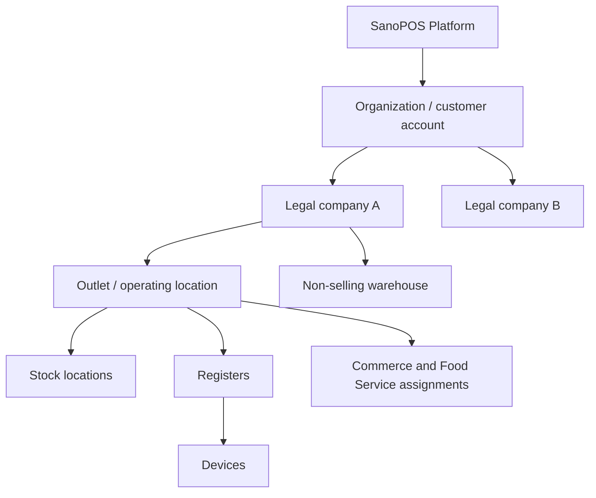
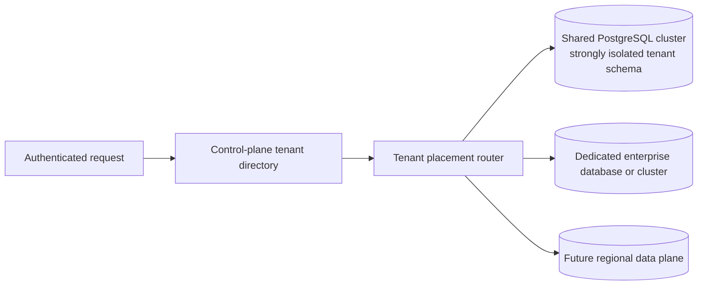

# Enterprise Hierarchy, Ownership, and Tenancy

## Canonical hierarchy



### Organization

The commercial customer account and management boundary. It owns subscription relationships, organization-level identities, shared catalog identity, consolidated management reporting, and infrastructure placement metadata.

### Legal company

A registered business entity. It owns accounting, tax, invoice sequences, contracts, balances, regulatory settings, and official reports. The initial release exposes one legal company; the data model and authorization model must be multi-company ready.

### Outlet

A physical or operational business location. An outlet may run multiple modules but has one primary module for its default experience. Outlets own operational configuration, shifts, and location context; they do not own the legal ledger.

### Stock location

A physical or logical inventory custody point such as a sales floor, backroom, central warehouse, kitchen, damaged-stock area, in-transit location, or delivery vehicle.

### Register

A configured transaction workstation. It has an operational profile, receipt configuration, cash drawer, device assignments, and locally unique sequencing policy.

### Device

A registered Windows terminal, tablet, kitchen display, customer display, or other authenticated endpoint. Device identity is separate from employee identity.

## Multi-module outlets

An outlet may enable multiple modules. A hotel may eventually operate Lodging, Food Service, Appointments, and Commerce at one location. Employees and devices receive focused assignments rather than universal access.

The launch examples are:

```text
Outlet A
├── Primary: Commerce / Retail
└── Optional: Food Service / Counter

Outlet B
├── Primary: Food Service / Table
└── Optional: Commerce / Retail
```

## Tenant control plane and data planes

The target separates platform routing metadata from tenant business data.



The control plane contains organization identity, subscription state, module entitlement summary, region, database placement, application compatibility, and migration status. It must not become a second store for ordinary sales or customer transactions.

## Tenant-scoped data access

Domain code requests a tenant-scoped unit of work from one database router. It must not manipulate PostgreSQL `search_path`, choose schemas, or acquire unwrapped global clients.

Target rules:

- Tenant placement is resolved before domain execution.
- Every connection is scoped, reset, and released by infrastructure code.
- Transactions explicitly carry organization and legal-company context.
- Background jobs resolve the same context through the same router.
- Cache keys include tenant and applicable legal-company scope.
- Imports, exports, files, and observability metadata retain tenant scope.
- Automated isolation tests attempt cross-tenant access through every infrastructure path.

The target directly addresses the current manual-client risk in [`backend/tenant-db-manager-pg.js`](../../../backend/tenant-db-manager-pg.js#L89) and the safer reset pattern already demonstrated in [`backend/workers/tenant-job-context.js`](../../../backend/workers/tenant-job-context.js#L48).

## Standard and Enterprise placement

Standard customers use strongly isolated schemas in shared managed PostgreSQL. Enterprise customers may use a dedicated database, cluster, region, backup policy, or maintenance window. The logical domain contract remains identical.

Placement changes are controlled operations:

1. Quiesce or journal writes.
2. Produce a consistent backup or logical copy.
3. Restore and validate the target data plane.
4. Verify counts, balances, checksums, and schema version.
5. Atomically update control-plane routing.
6. Monitor and retain a rollback window.

## Authorization context

Every request resolves:

```text
Organization
→ Legal company
→ Outlet when required
→ Register/device when applicable
→ Employee identity
→ Employment relationship
→ Assignment and effective permissions
```

The current middleware already separates several context stages in [`backend/routes/registerAllRoutes.js`](../../../backend/routes/registerAllRoutes.js#L236). vNext formalizes this as a typed request context shared by HTTP, jobs, synchronization, and administrative operations.

## Legal-company boundary rules

- Accounting and tax never silently cross legal companies.
- Ordinary inventory transfers occur only within a legal company.
- Intercompany stock requires a future commercial purchase/sale workflow.
- Stored value is legal-company and currency scoped.
- Customer and supplier identity may be linked at organization level, but commercial relationships and balances remain separate.
- Consolidated organization reporting is managerial, not an official legal-company ledger.

## Initial-release simplification

The user experience initially provisions one organization, one legal company, and one or more outlets. IDs and ownership fields still follow the complete hierarchy. This avoids a future data migration that tries to infer legal ownership from outlets or tenant schemas.
