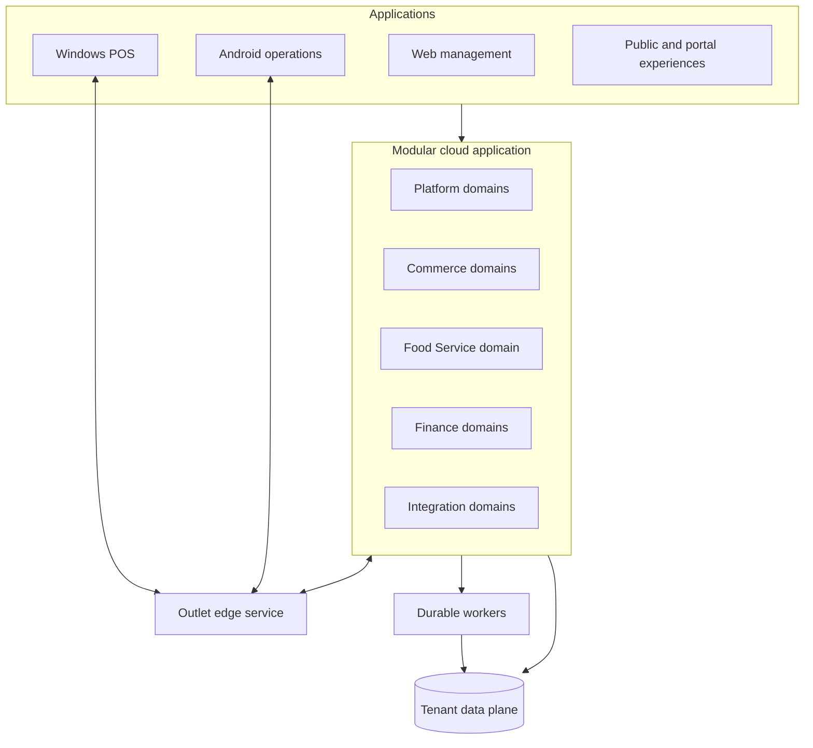
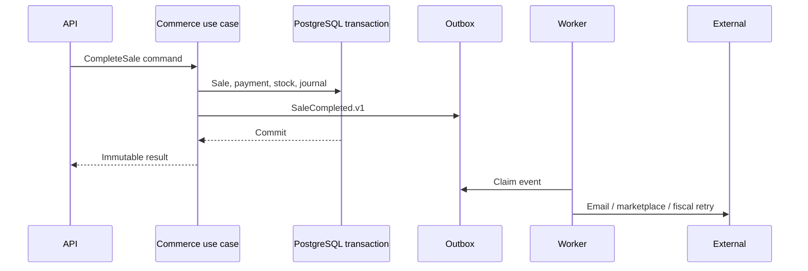

# Platform and Domain Architecture

## Deployment style

The main cloud application is a strongly modular monolith. The edge service, Hardware Gateway, workers, and eventually high-volume analytical components are separately deployable where their operational needs differ.



## Domain map

| Domain | Primary ownership |
|---|---|
| Identity and Access | Users, authentication, sessions, MFA, service accounts |
| Organization | Organizations, legal companies, outlets, stock locations, registers, devices |
| Subscription | Trials, plans, entitlements, usage allowances, lifecycle |
| Module Runtime | Installation, activation, setup, outlet assignment, profile resolution |
| Catalog | Canonical items, variants, units, barcodes, categories, media |
| Pricing and Tax | Price lists, agreements, promotions, tax calculation, immutable snapshots |
| Customer | Customer identity, legal-company relationship, addresses, consent |
| Loyalty and Stored Value | Loyalty ledgers, wallets, store credit, gift cards |
| Supplier and Procurement | Supplier accounts, purchase orders, receiving, supplier returns |
| Inventory | Stock locations, movements, transfers, counts, batches, serials, reservations |
| Commerce | Retail and wholesale quotes, orders, sales, fulfillment, returns |
| Food Service | Menus, tables, checks, modifiers, kitchen, courses, tips, service modes |
| Payment | Tenders, gateway intents, captures, refunds, reconciliation |
| Accounting | Journals, accounts, periods, receivables, payables, valuation |
| Reporting | Operational read models, scheduled reports, consolidated analytics |
| Notification | Email, SMS, WhatsApp, in-app messages, templates, preferences |
| Integration | Marketplace, courier, fiscal, payment, and external adapter orchestration |
| Audit and Compliance | Immutable audit events, retention, exports, legal holds |

## Domain module shape

```text
modules/<domain>/
├── domain/          Pure rules, entities, value objects
├── application/     Use cases and transaction orchestration
├── infrastructure/  Repositories and external adapters
├── api/             HTTP and event contract adapters
├── frontend/        Domain workspace components when shared
├── contracts/       Public typed commands, queries and events
├── tests/           Unit, integration, contract and journey coverage
└── README.md        Ownership, invariants and dependencies
```

This is a target shape, not an instruction for a one-time folder move.

## Dependency rules

- API routes validate, authorize, call an application use case, and translate the result.
- Domain code does not import HTTP, React, PostgreSQL clients, or vendor SDKs.
- Repositories expose domain-specific operations, not a global raw query object.
- A domain may read another domain through an application query contract.
- A domain changes another domain through a command or published event, not direct table writes.
- Cross-domain operations that must be atomic use an explicitly owned application transaction.
- Secondary work uses a transactional outbox and idempotent consumers.

The current large route-centered transaction in [`backend/routes/sales.js`](../../../backend/routes/sales.js#L1697) demonstrates why sales rules, inventory effects, financial posting, and external side effects require explicit ownership.

## Transaction categories

### Synchronous invariants

The sale, accepted payments, required stock movement, required legal invoice record, and core accounting posting must either commit together or fail together where the business rules demand it.

### Durable asynchronous reactions

Email, marketplace updates, non-critical analytics, customer notifications, and retryable fiscal submission are triggered through outbox events. External failure must not roll back a valid sale.



## Repository organization

Keep one repository initially, organized conceptually into:

```text
applications/  cloud API, web, workers, edge, Windows POS, mobile
platform/      identity, organization, subscription, audit, localization
modules/       business-domain packages
shared/        contracts, design system, events, observability, test tools
```

Shared contracts are strict TypeScript. Existing JavaScript is converted domain by domain. Node.js, React, Express, PostgreSQL, and Vite remain; architecture modernization does not require a framework rewrite.

## Service-extraction criteria

Extract a domain into an independent network service only when at least one condition is proven:

- Independent scaling is required and measured.
- A stricter security boundary is necessary.
- A separate team owns deployment and operations.
- Failure isolation materially improves Tier 1 reliability.
- Regional or customer-specific placement demands it.

Before extraction, the module must already possess stable contracts and no uncontrolled cross-domain database writes.

## Architecture enforcement

- Dependency-rule linting or import-boundary tests
- Table-ownership registry
- Contract compatibility tests
- ADR reference in significant changes
- Domain README and invariants
- Architecture checks in CI
- No new global utility layer that contains business decisions from multiple domains
