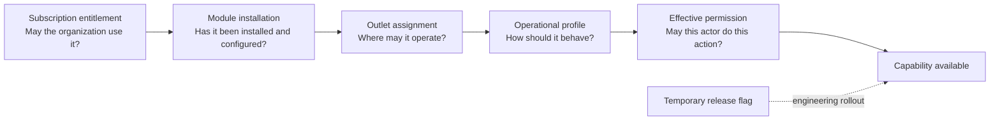

# Capability, Entitlement, Module, Profile, and Permission Model

## Objective

The current application uses overlapping presets, modes, Business Modules, feature flags, permissions, outlet configuration, and plan gates. Current definitions can be inspected in [`industry-config.js`](../../../backend/config/industry-config.js#L1), [`mode-registry.js`](../../../backend/config/mode-registry.js#L1), [`business-modules.js`](../../../backend/config/business-modules.js#L96), and [`feature-flags.js`](../../../backend/middleware/feature-flags.js#L24).

vNext assigns one responsibility to each layer.



## Subscription entitlement

Commercial availability only. It contains plan, trial, contractual, usage, or support constraints. It does not grant employee access and does not control UI layout.

## Module installation

An organization installs a permitted module. Installation creates required configuration, permissions, templates, and setup tasks. Module lifecycle:

```text
Unavailable → Available → Setup Required → Active → Suspended → Archived
```

Archiving preserves historical transactions and audit data.

## Legal-company activation and outlet assignment

A module may be available to the organization but active only for selected legal companies and outlets. The first release has one legal company but retains this scope.

## Operational profile

Profiles provide behavior and experience defaults:

- Commerce: Retail, Wholesale, Hybrid
- Food Service: Table Service, Counter Service, Hybrid

Profiles may be selected per outlet or register where appropriate. They must not duplicate the domain model.

## Permission

Permissions answer who may perform a business action in a resolved context. Effective authorization combines:

- Organization membership
- Active legal-company employment
- Outlet and module assignment
- Base role
- Outlet override role where explicitly configured
- High-risk approval policy
- Device or register restrictions

The existing permission catalog is implemented in [`backend/config/permissions-catalog.js`](../../../backend/config/permissions-catalog.js#L23). vNext permissions should become domain-owned, stable identifiers collected into one generated platform catalog.

## Release flag

Release flags are temporary engineering controls for previews, staged rollout, migrations, and emergency shutdown. They must have an owner, purpose, creation date, target removal condition, and safe default. Stable module configuration must not remain permanently encoded as release flags.

## Country package

Country packages are regulatory configuration and adapters. They are separate from modules, plans, profiles, and permissions.

## Capability explanation

Every unavailable action should be diagnosable:

```text
Capability: food_service.table.transfer
├── Entitlement permits Food Service: yes
├── Module active: yes
├── Outlet assigned: yes
├── Register profile supports tables: yes
├── Employee assigned: yes
├── Permission granted: no
├── Release state: production
└── Result: denied — missing permission
```

The same resolver should power backend authorization, frontend presentation hints, support diagnostics, and audit evidence. Backend authorization remains authoritative.

## Activation workflow

1. Subscription makes a module available.
2. An authorized owner chooses to install it.
3. A module-specific wizard collects mandatory settings.
4. The owner assigns legal companies and outlets.
5. Default roles and permissions are reviewed.
6. Registers select operational profiles.
7. Readiness checks pass.
8. The module becomes active.

## Pricing relationship

Ordinary launch modules are included in the initial Business plan. Activation does not create an extra charge. The entitlement architecture still supports future premium services, temporary access, trials, direct-cost allowances, and Enterprise contracts.

## Migration from current controls

Create an explicit mapping table from every current preset, mode, flag, Business Module, and route gate to its target responsibility. During transition:

- New capability resolution is authoritative for migrated domains.
- Compatibility adapters explain old-to-new mapping.
- No new permanent controls are added to legacy layers.
- Each legacy control has a removal milestone.
- Data migration preserves active customer configuration where meaningful.

The setup wizard currently writes presets, modes, flags, roles, and other defaults together in [`backend/routes/setup.js`](../../../backend/routes/setup.js#L192). vNext setup becomes orchestration over separate domain-owned configuration services.
