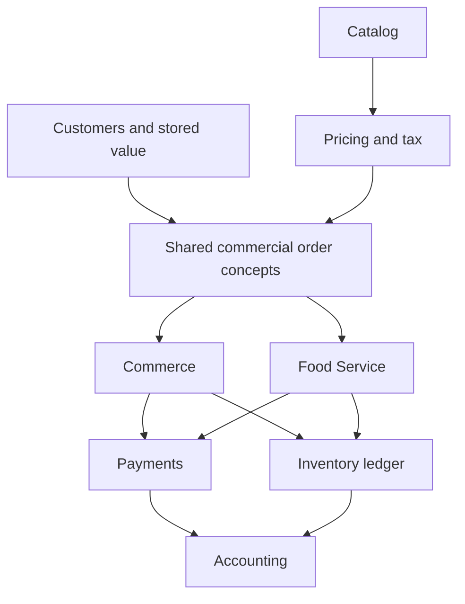

# Commerce and Food Service Launch Architecture

## Shared commercial foundation

Commerce and Food Service reuse platform domains rather than maintaining separate customer, inventory, payment, tax, or reporting systems.



Shared concepts include money, tax, tender allocation, customer identity, catalog references, immutable price snapshots, discounts, fulfillment, returns, audit identity, and idempotency.

## Commerce module

### Retail profile

Optimized for barcode and touch checkout:

- Shift and register open/close
- Product scan, search, weighted barcode, and variants
- Customer attachment
- Pricing, promotions, tax, and controlled overrides
- Cash, card, wallet, gift card, credit, and split tender
- Receipt and fiscal status
- Returns, exchanges, voids, and corrections
- Stock, batch, and serial effects
- Offline completion and replay protection

The current transaction breadth can be studied in [`backend/routes/sales.js`](../../../backend/routes/sales.js#L595) and current POS composition in [`frontend/src/pages/redesign/POSRedesign.jsx`](../../../frontend/src/pages/redesign/POSRedesign.jsx#L1).

### Wholesale profile

Optimized for account customers and fulfillment:

- Customer-specific agreements and price lists
- Quotations
- Sales orders
- Minimum quantities and pack units
- Credit limits, payment terms, and approvals
- Reservation and allocation
- Partial fulfillment and backorders
- Delivery, proof of delivery, invoicing, statements, and returns
- Salesperson and commission attribution

### Hybrid profile

One outlet can run a fast retail counter and a wholesale order desk over the same catalog, inventory, customers, and accounting. Register and employee assignments determine the default workflow.

## Food Service module

Restaurant and café are not separate modules. Food Service contains profiles:

### Table Service

- Floor plans, tables, seats, and server sections
- Open checks and tabs
- Waiter ordering
- Modifiers, courses, firing, and kitchen routing
- Table transfer and merge
- Split by seat, item, amount, or guest
- Tips, service charges, discounts, voids, and comps
- Reservations where enabled
- Pay after dining

### Counter Service

- Fast menu POS
- Pay-before-preparation default
- Customer name or order number
- Takeaway, pickup, delivery, and optional table number
- Barista or kitchen display
- Minimal floor-management surface

### Hybrid Service

- Counter and table ordering in one outlet
- Pay before or after service by order type
- Multiple register profiles
- Shared kitchen and menu
- Dine-in, takeaway, delivery, and curbside

The current Food Service implementation already spans checks, tables, kitchen, tips, and other workflows; the current-state domain summary is in [Functional Domains](../technical-architecture-report/04-functional-domains.md).

## Register-specific behavior

An outlet has one primary module, while each register selects an operational profile and permitted order types.

```text
Food outlet
├── Front counter → Counter Service
├── Dining tablet → Table Service
├── Manager terminal → Hybrid and management
└── Kitchen display → Kitchen workspace
```

Profile selection changes defaults and presentation, not financial or order integrity rules.

## Order model boundaries

Commerce and Food Service may share foundational order value objects but keep domain-specific aggregates.

- A Commerce order owns quotation, allocation, fulfillment, invoice, and return semantics.
- A Food Service check owns table, seat, course, kitchen, preparation, and split semantics.
- Both produce a standardized settlement request for Payment.
- Both publish standardized completed-sale facts for Accounting and Reporting.
- Neither directly edits wallet, inventory, or journal tables.

## Pricing and tax snapshots

Every completed line stores:

- Catalog and variant reference
- Display name and SKU snapshot
- Unit and quantity
- Base and effective price
- Applied price list and rule identifiers
- Discount components and authorization
- Tax classification, rate, inclusivity, and calculated amount
- Channel, outlet, register, and employee
- Recipe or component snapshot where legally or operationally required

Future catalog changes never alter historical transactions.

## Returns, voids, and corrections

- Completed sales are not deleted.
- A return references original sale lines where possible.
- A void or cancellation records actor, reason, approval, and financial/stock reversal.
- Food preparation already begun may require waste or comp handling rather than deletion.
- Fiscal credit/debit documents follow the country package.
- Offline corrections use unique, idempotent events.

## Food inventory and recipes

Recipes consume the common inventory ledger. A menu item may be:

- A stocked resale item
- A recipe produced at order time
- A prepared batch
- A configurable combo
- A non-stock service charge

Kitchen production, waste, yield, substitutions, and unit conversion become Inventory operations invoked through Food Service use cases.

## Launch readiness journeys

The module is not Production until automated and human validation covers:

1. Retail sale through shift reconciliation
2. Retail return, exchange, void, and duplicate request
3. Wholesale quote through partial fulfillment and payment
4. Wholesale credit failure and approval
5. Counter order through kitchen and pickup
6. Table order through split payment and tip
7. Offline operation and later synchronization
8. Printer, fiscal, messaging, and gateway failure without transaction loss
