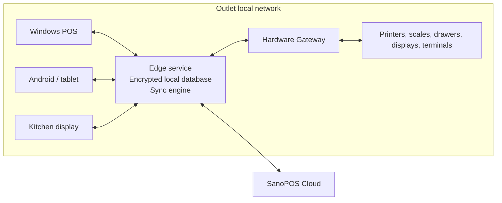

# Cloud, Edge, Offline Synchronization, and Hardware

## Edge architecture



## Two offline service levels

### Basic offline

For one-register customers and short outages, the client caches required data and queues supported transactions. This evolves from the existing IndexedDB queue in [`frontend/src/utils/offlineQueue.js`](../../../frontend/src/utils/offlineQueue.js#L1), but it must adopt the same event contracts and diagnostics as full edge mode.

### Full outlet edge

For multi-register retail and Food Service, a persistent local service coordinates devices over the outlet network and operates for hours or days without cloud connectivity.

The edge service provides:

- Encrypted embedded database, likely SQLite after prototype validation
- Local authentication lease validation
- Local order and transaction processing
- Register and device coordination
- Kitchen state and print routing
- Durable outbox and inbox
- Synchronization checkpoints
- Local diagnostics, backup, and recovery
- Controlled update compatibility

Closing a POS window must not stop the edge service.

## Authority model

- Cloud owns organizations, entitlements, identities, permissions, catalog definitions, price rules, tax configuration, and cross-outlet coordination.
- Edge owns valid operational events it accepted during an outage.
- Completed events are never discarded merely because cloud state later differs.
- Cloud reconciliation creates explicit exceptions rather than overwriting local history.

## Synchronization protocol

Each event includes:

- Globally unique event ID
- Contract type and version
- Organization, legal-company, outlet, register, and device IDs
- Actor and authorization lease
- Local monotonic sequence
- Creation and receipt times
- Idempotency key
- Correlation and causation IDs
- Complete applicable pricing, tax, and configuration snapshots
- Payload checksum

### Outbound flow

1. Edge commits the business transaction and outbox event atomically.
2. Sync sends ordered batches with checkpoint information.
3. Cloud authenticates device and validates contract compatibility.
4. Cloud deduplicates and applies the event transactionally.
5. Cloud returns durable acknowledgement and reconciliation status.
6. Edge retains required history and advances its checkpoint.

### Inbound flow

Cloud distributes versioned configuration changes. Edge applies them in order, records the effective version, and refuses incompatible mandatory configuration until safely updated.

## Conflict policy

| Conflict | Policy |
|---|---|
| Cloud price changed during outage | Preserve locally completed sale snapshot; new price applies after sync |
| Two outlets sell scarce shared stock | Preserve valid sales; create shortage/reconciliation exception |
| Duplicate customer created | Preserve both, flag candidate merge |
| Employee disabled during outage | Cached authorization expires by risk-based lease |
| Same restaurant check edited | Local edge serializes updates for its devices |
| Duplicate event delivery | Idempotent acknowledgement, no duplicate business effect |
| Fiscal endpoint offline | Apply country fallback and durable submission queue |

## Initial offline operations

Supported target:

- Cached employee login
- Shift and cash management
- Retail sale and locally resolvable return
- Counter and table orders
- Kitchen display and printing
- Cash and locally confirmed terminal tender
- Receipt production
- Cached customer lookup and limited creation
- Local stock movement
- Durable synchronization and visible recovery

Initially cloud-dependent or restricted:

- Subscription and permission administration
- Major catalog redesign
- Cross-outlet transfer coordination
- Purchasing and organization-wide reports
- Online-only gateway authorization
- External marketplace and courier activity
- Compliance actions that legally require live connectivity

## Hardware Gateway

Applications send capability-oriented jobs to a local authenticated gateway. Adapters implement vendor and protocol differences.

```text
Application command
→ Durable hardware job
→ Capability adapter
→ Transport/driver
→ Device
→ Result, retry or redirect
```

Device classes:

- ESC/POS receipt and kitchen printers
- Barcode scanners, initially keyboard mode
- Serial/USB/network weighing scales
- Cash drawers through printer or supported controller
- Customer displays
- Integrated or external payment terminals
- Selected biometric devices
- ZPL/TSPL or supported label printers

The current printer service already implements USB/TCP concepts in [`backend/services/printer.js`](../../../backend/services/printer.js#L35). vNext moves outlet hardware ownership and durable execution to the local gateway.

## Print integrity

Print failure never invalidates a committed sale. Jobs record original/reprint status, template version, destination, attempts, result, and authorized redirection. Reprints require appropriate permission and are visibly marked where necessary.

## Device certification

Publish Certified, Compatible, and Unsupported categories. A certified model passes protocol, failure, reconnect, driver, offline, update, and sustained-operation tests on supported Windows versions.

## Security and loss recovery

- Device enrollment uses one-time, expiring authorization.
- Edge identity uses rotatable certificates or equivalent keys.
- Local database and secrets are encrypted.
- High-risk cached permissions have short leases.
- A lost device can be revoked remotely.
- Edge backups and logs exclude recoverable payment secrets.
- Reinstall and re-pair procedures avoid transaction duplication.
