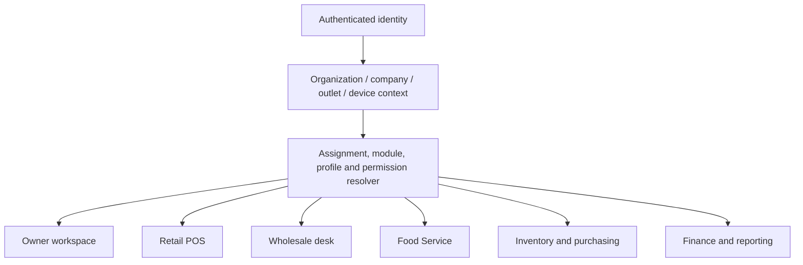

# Frontend Workspaces and Design System

## Experience architecture

SanoPOS uses one platform shell with focused workspaces rather than one universal sidebar exposing the entire product.



## Workspace catalog

### Owner and manager

Organization/outlet performance, approvals, alerts, subscriptions, configuration, and consolidated reporting.

### Retail POS

Fast barcode/touch selling, customer attachment, payment, receipt, return, shift, and synchronization status.

### Wholesale desk

Account customers, quotations, orders, price agreements, credit, allocation, fulfillment, invoices, and statements.

### Food Service

Profile-specific counter, table, waiter, kitchen, order status, check settlement, and manager experiences.

### Inventory and purchasing

Catalog operational details, receiving, transfers, counts, batches, serials, waste, and supplier workflow.

### Finance and reporting

Cash reconciliation, receivables, payables, settlement, tax, journals, and role-appropriate analytics.

## Context model

The global switcher selects organization, legal company, and outlet. Workspace selection follows assignment and device purpose. A register-bound device normally opens directly to its configured operational workspace.

Employees cannot use frontend hiding as authorization. The backend evaluates the same capability context authoritatively.

## Design system

One versioned design-system package owns:

- Typography, color, spacing, elevation, and motion tokens
- Forms, buttons, inputs, tables, filters, dialogs, and navigation
- Loading, empty, error, offline, conflict, and permission-denied states
- Touch targets and keyboard interaction
- Accessibility requirements
- Date, number, currency, unit, and timezone presentation
- Responsive and high-density layouts
- Print and customer-display primitives where applicable

The current primitives begin in [`frontend/src/ui/primitives.jsx`](../../../frontend/src/ui/primitives.jsx#L1). vNext evolves them into tested components with documented usage and removes page-local reinvention.

## Frontend code ownership

Organize by domain and workspace:

```text
applications/web/
├── shell/
├── workspaces/
└── routes/

modules/commerce/frontend/
modules/food-service/frontend/
modules/inventory/frontend/
shared/design-system/
shared/contracts/
```

Page routes compose domain use cases and design components. They do not implement tax, pricing, stock, or permission rules.

## Data access

- One typed query/mutation layer consumes generated contracts.
- Query keys include tenant and context.
- Mutations expose idempotency and retry classification.
- Offline-capable commands are routed through edge or local queue deliberately.
- Server state, local interaction state, and durable offline state are separate.
- Errors preserve stable code and request ID.

The current global fetch patch in [`frontend/src/auth/AuthProvider.jsx`](../../../frontend/src/auth/AuthProvider.jsx#L345) demonstrates useful centralized behavior but mixes session, transport, offline, and subscription concerns. vNext splits these into typed authentication, transport, context, and synchronization clients.

## POS decomposition

The current POS context coordinates many hooks in [`frontend/src/pages/redesign/pos/POSContext.jsx`](../../../frontend/src/pages/redesign/pos/POSContext.jsx#L74). vNext separates:

- Pure cart and price presentation state
- Commerce application commands
- Payment workflow
- Shift/register state
- Customer and stored-value interaction
- Receipt presentation
- Hardware jobs
- Offline/sync state

Domain behavior stays shared across browser, Windows, and future mobile clients.

## Accessibility and localization

- Keyboard-first retail operation
- Touch-first waiter and counter layouts
- Screen-reader labels and focus management
- Color-independent status
- RTL-ready layout where future countries require it
- User language independent of legal-company country
- Explicit local and legal timestamps
- Currency and unit formatting through shared libraries

## Experience quality gates

Every launch journey defines task completion time, error recovery, offline presentation, accessibility checks, empty/loading/error states, and small/large data behavior. Founding-customer observation is required; visual polish alone is not acceptance.
