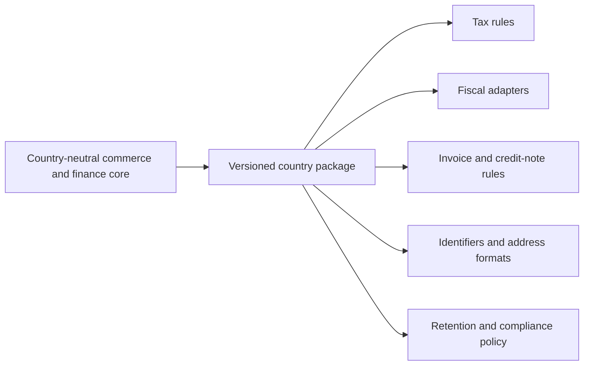

# Security, Privacy, and Country Packages

## Security baseline

Security is a platform capability included in every plan. Enterprise may add contractual controls or isolation, but ordinary customers do not receive weaker tenant isolation, encryption, or audit integrity.

## Identity security

- Unique human identities; shared administrator accounts prohibited
- MFA required for platform administrators and recommended/enforceable for owners
- Short-lived access tokens and rotating refresh tokens
- Session/device inventory and immediate revocation
- Risk-based reauthentication for refunds, exports, permission changes, and secrets
- Scoped service accounts for integrations
- Rate limiting backed by shared infrastructure in multi-instance deployment
- Secure recovery codes and account-recovery audit

The current staff token system already implements access/refresh concepts in [`backend/jwt-auth.js`](../../../backend/jwt-auth.js#L12), while admin authentication is separate in [`backend/routes/admin/auth.js`](../../../backend/routes/admin/auth.js#L50). vNext unifies security policy without merging scopes.

## Tenant and authorization security

- Tenant router is the only business-data entry path.
- Domain repositories require typed tenant and legal-company context.
- Raw global database access is unavailable to routes and extensions.
- Employee identity, employment, outlet assignment, module assignment, register policy, and permission are independently verified.
- Background work and file access use the same tenant context rules.
- Isolation tests run against HTTP, job, import, export, cache, file, public-route, and edge-sync paths.
- Platform impersonation is time limited, prominently visible, and fully audited.

## Encryption and secret management

- TLS for all external and service communication
- Managed at-rest encryption for cloud databases and backups
- Encrypted edge databases and device secrets
- Credential vault or managed secret store for provider credentials
- Key versioning and rotation
- Environment validation that refuses unsafe production startup
- No plaintext fallback for missing integration keys

The current generalized crypto service can return plaintext when no key is configured in [`backend/services/crypto.js`](../../../backend/services/crypto.js#L20). vNext makes the production key mandatory and provides a migration path for legacy values.

## Payment security

SanoPOS stores provider references, amount, currency, state, reconciliation, and safe metadata. Raw card number, CVV, and equivalent sensitive authentication data are not stored. Provider tokenization and certified terminal flows minimize PCI scope.

## Audit model

Immutable audit events record:

- Identity, role, assignment, and permission changes
- Price and discount overrides
- Refunds, returns, voids, and comps
- Inventory adjustments and discrepancies
- Financial correction and period activity
- Stored-value issuance and change
- Data exports and privacy actions
- Integration-secret access/change
- Module and entitlement changes
- Impersonation, backup restore, and administrative operations

Audit records include actor, delegated/impersonating actor, tenant context, target, before/after-safe summary, reason, request/device ID, and time.

## Privacy architecture

Classify data as public, internal, confidential, sensitive personal, financial, authentication secret, or regulated. Apply collection minimization, purpose, access, retention, export, correction, anonymization, and legal-hold policy.

Customer consent is legal-company scoped and channel/purpose specific. Cross-company customer linking must not silently share marketing consent, balances, or protected history.

## Country-package architecture

Country packages are attached to legal companies. Language, timezone, currency, tax, and compliance are separate concerns.

### Pakistan

First Production target: PKR defaults, province-aware tax, FBR behavior, invoices/credit/debit documents, local identifiers, and validated fallback during fiscal-system outage. Current FBR implementation is anchored in [`backend/services/fbr.js`](../../../backend/services/fbr.js#L4).

### UAE

Future Preview after qualified validation: AED, VAT, TRN, tax invoice and credit-note rules, retention, and relevant payment/address patterns.

### United States

Future Preview after qualified validation: state/local tax, exemptions, sourcing rules, tips, external tax-provider strategy, and state-specific obligations.

## Country maturity

Unavailable → Experimental → Preview → Production. A country is not marketed as supported until taxes, invoices, returns, payments, fiscal behavior, reporting, and retention have been locally validated.

## Multi-currency

Each legal company initially has one accounting currency. Future foreign-currency transactions retain transaction currency, accounting currency, exchange rate source/version, and realized/unrealized difference. Consolidated reporting maps to an organization reporting currency without changing source ledgers.

## Security program

- OWASP-aligned secure-development requirements
- Dependency, secret, and static scanning
- Threat modeling for new boundaries
- Independent penetration test before broad launch
- Incident response and breach assessment
- Regular access review
- Backup restoration and ransomware scenarios
- Future SOC 2 or ISO 27001 only when business need justifies formal certification

Clinical and other highly regulated verticals remain Experimental until their country-specific privacy and professional requirements receive separate assessment.
