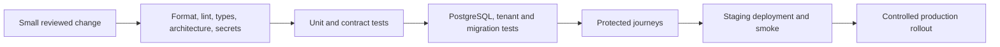

# Testing, Reliability, Release, and Operations

## Quality strategy

The new suite replaces existing tests deliberately, not through a blanket deletion. Existing tests are classified as valuable, failing, duplicate, implementation-coupled, obsolete, or flaky. Useful behavior is preserved through new architecture-aligned coverage before superseded tests are removed.

Current test scale and limitations are recorded in [Data, Testing, and Deployment](../technical-architecture-report/07-data-testing-and-deployment.md).

## Test layers

| Layer | Purpose |
|---|---|
| Domain unit | Pure pricing, tax, inventory, payment, accounting, and workflow rules |
| PostgreSQL integration | Transactions, constraints, repositories, concurrency, tenant routing |
| API/security | Authentication, permissions, isolation, validation, idempotency |
| Contract | Cloud/edge/client/event compatibility |
| Migration | Fresh schema and upgrades from every supported baseline |
| End-to-end | Complete launch-critical business journeys |
| Hardware contract | Shared adapter behavior plus certified physical-device runs |
| Load/resilience | Capacity, failure isolation, retry, recovery, and outage operation |

Mocks are appropriate at external boundaries but do not replace real PostgreSQL tests for database behavior.

## Fifteen launch quality gates

1. Signup and business setup
2. Employee access and security
3. Outlet and register management
4. Subscription and account recovery
5. Catalog, pricing, and taxation
6. Purchasing and receiving
7. Inventory control
8. Customer management
9. Retail sale lifecycle
10. Wholesale order lifecycle
11. Food Service order lifecycle
12. Offline operation and synchronization
13. Hardware operation
14. Financial control and reporting
15. Administration and support

Each gate requires requirements, security and permission coverage, tenant isolation, offline behavior, failure recovery, audit, tests, documentation, performance criteria, and end-to-end verification.

## CI pipeline

Required environments: Development, production-like Staging, and Production. Experiments use internal test organizations and cannot silently expose unfinished capability to customers.

## Migration safety

Use expand-and-contract:

1. Add backward-compatible structure.
2. Deploy code supporting old and new forms.
3. Backfill through observable, resumable jobs.
4. Reconcile counts, money, stock, and constraints.
5. Switch reads/writes.
6. Remove old structure in a later release.

Required tenant migration failure blocks rollout. The current runner can continue after a tenant failure; the target closes that drift risk identified in [Risks and Assessment](../technical-architecture-report/08-risks-and-assessment.md).

## Reliability objectives

Initial engineering objectives:

- 99.9% cloud availability
- Four-hour major-disaster recovery time
- Approximately five-minute cloud recovery-point exposure
- Edge retains unacknowledged local transactions
- Tier 2 failure never blocks Tier 1 checkout

These become contractual only after measurement and operational validation.

### Tier 1

Authentication, tenant routing, POS/order processing, payment recording, edge operation, synchronization, and inventory transaction recording.

### Tier 2

Email, messaging, marketplace synchronization, AI, large reports, scheduled exports, and non-critical analytics.

## Observability

Every request, job, edge event, hardware job, and integration attempt carries request, correlation, tenant-safe, and device identifiers.

Collect:

- Structured logs with redaction
- Metrics for latency, errors, saturation, queue depth, sync lag, payment state, and migration drift
- Distributed traces across API, worker, database, and external calls
- Business-health indicators such as checkout failure and unreconciled payments
- Immutable operational incidents and acknowledgement

Current request IDs and Pino are implemented in [`backend/middleware/request-id.js`](../../../backend/middleware/request-id.js#L15); current alerting is process-local in [`backend/services/alerting.js`](../../../backend/services/alerting.js#L6). vNext moves multi-instance state to shared observability and coordination services.

## Graceful operation

Processes handle termination by stopping new work, draining requests, releasing jobs, flushing telemetry, closing database pools, and stopping pg-boss. The existing `shutdownBoss` in [`backend/services/boss.js`](../../../backend/services/boss.js#L46) becomes part of a complete lifecycle.

## Release policy

Internal tenants → founding customers → small cohort → all eligible customers. Every release records version, changes, migrations, evidence, known limitations, recovery plan, monitoring, and owner.

## Incident playbooks

Required before paid launch:

- Database failure and point-in-time restore
- Bad application or migration deployment
- Tenant isolation incident
- Payment duplication or ambiguous result
- Edge sync corruption or prolonged outage
- Lost or compromised outlet device
- Credential compromise
- Fiscal-provider outage
- Queue backlog/dead-letter growth
- Regional cloud outage

Backups are only considered valid after automated and periodic human restoration tests.
