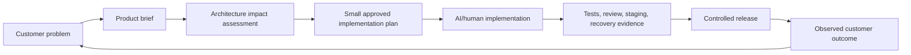

# AI-Assisted Engineering Governance

## Operating model

The founder owns product intent, customer priorities, commercial rules, and approval. Architecture records define boundaries. AI tools inspect and implement. Experienced humans independently review high-risk work.



## Required product brief

Before meaningful coding:

- Customer and problem
- Desired outcome and non-goals
- Launch workflow and owning domain
- User roles and contexts
- Normal, failure, offline, and recovery behavior
- Security, privacy, tax, and financial sensitivity
- Success measurement
- Existing behavior to preserve or retire

## Required architecture impact assessment

- Domain ownership and dependencies
- API/event contract changes
- Database ownership and migration
- Tenant/legal-company/outlet scope
- Permissions, approvals, and audit
- Edge/offline and hardware behavior
- Integration and country-package impact
- Frontend workspace and accessibility
- Tests, observability, rollback, and documentation
- ADR requirement

## Implementation rules for AI agents

- Inspect actual source before asserting current behavior.
- Treat architecture documents as target intent, not proof that code implements it.
- Grep for one relevant implementation and test reference before editing.
- Keep tasks bounded to one coherent behavior.
- Do not add a second mechanism when a domain owner exists.
- Do not introduce permanent feature flags without owner and removal condition.
- Do not perform direct cross-domain table writes.
- Use typed contracts and standard errors.
- Include failure, retry, idempotency, permission, and tenant behavior.
- Preserve unrelated user changes.
- Report verification evidence and known limitations honestly.

## High-risk change review

Experienced human review is mandatory before production for:

- Tenant routing and database access
- Authentication, sessions, permissions, and impersonation
- Payments, wallets, gift cards, credit, and accounting
- Tax and fiscal compliance
- Database migrations and data repair
- Edge synchronization and conflict policy
- Encryption, secrets, privacy export/deletion
- Deployment, backup, restore, and incident response

## Definition of done

A meaningful change is done only when:

- Accepted behavior and non-goals are met.
- Domain boundaries remain valid.
- Contracts and migrations are compatible.
- Tests pass at the appropriate layers.
- Security and tenant scopes are verified.
- Observability and support diagnostics exist.
- Staging behavior is verified.
- Documentation and ADRs are updated.
- Recovery or rollback is understood.
- Superseded legacy code has a removal disposition.

## Prompt template

```text
Problem:
Owning domain:
User and context:
Current source evidence:
Desired behavior:
Non-goals:
Financial/security/offline implications:
Affected contracts and data:
Acceptance criteria:
Required tests:
Migration and rollback:
Documentation/ADR:
```

## Review separation

When practical, do not use the same AI pass as the only implementer and reviewer. Use separate implementation, test-gap, security, and architecture checks, followed by automated evidence. Multiple AI opinions do not replace a qualified human for high-risk production acceptance.

## Architectural memory

ADRs are the durable decision source. Domain READMEs contain invariants. Generated catalogs contain permissions, events, and capability IDs. Source code remains current implementation truth. Conversational history, agent guides, and generated summaries are never the sole authority.

## Metrics

Track outcomes rather than generated code volume:

- Escaped defects by launch workflow
- Change failure and rollback rate
- Lead time from approved brief to verified release
- Test reliability and protected-journey coverage
- Tenant/security incidents
- Migration and sync reconciliation failures
- Legacy mechanisms removed
- Founding-customer task success and support demand
