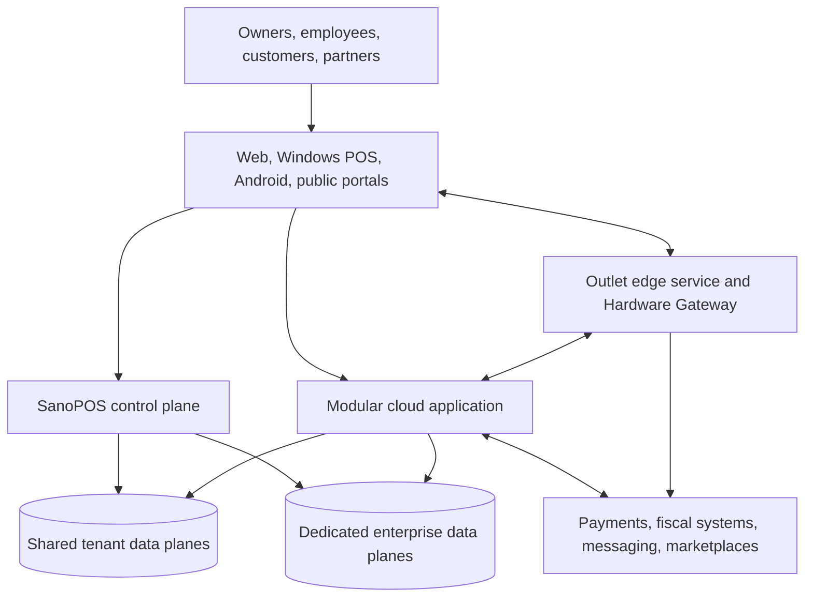

# SanoPOS vNext Platform Architecture

Status: **Proposed target architecture** — pending owner ratification decision by decision. Exception: the launch-scope decision ([ADR-002](adrs/ADR-002-modular-product-and-launch-scope.md) — Pakistan-first production, Commerce and Food Service only, UAE/USA as future previews) was explicitly ratified by the owner on 2026-07-17 and is Accepted.

Audience: product owner, architects, developers, AI coding agents, security reviewers, and investors performing technical diligence

This package defines the intended future architecture of SanoPOS. It is not a description of what the current code already implements.

For the verified current-state architecture, use the [Technical Architecture Report](../technical-architecture-report/README.md). That report was derived from executable source, SQL, tests, and deployment configuration. This package uses that evidence baseline and the product decisions accepted during the architecture discovery process.

## Product direction

SanoPOS will become a global, modular business operating platform. The first production-quality release focuses on:

- Retail
- Wholesale
- Restaurant and café operations
- Pakistan as the first production-supported country
- Cloud management with optional full outlet-edge operation
- Windows POS first, followed by Android operational applications

The long-term platform may serve additional industries, but new major vertical development is frozen until the shared foundation, Commerce, and Food Service meet production quality gates.

## Document index

1. [Product vision and architectural principles](01-product-vision-and-principles.md)
2. [Enterprise hierarchy, ownership, and tenancy](02-enterprise-hierarchy-and-tenancy.md)
3. [Platform and domain architecture](03-platform-domain-architecture.md)
4. [Capability, entitlement, module, profile, and permission model](04-capability-and-module-model.md)
5. [Commerce and Food Service launch architecture](05-commerce-and-food-service.md)
6. [Data ownership, finance, and reporting](06-data-finance-and-reporting.md)
7. [Cloud, edge, offline synchronization, and hardware](07-cloud-edge-offline-and-hardware.md)
8. [APIs, events, integrations, and extensions](08-api-events-integrations-and-extensions.md)
9. [Frontend workspaces and design system](09-frontend-workspaces-and-design-system.md)
10. [Security, privacy, and country packages](10-security-privacy-and-country-packs.md)
11. [Testing, reliability, release, and operations](11-quality-reliability-and-operations.md)
12. [Current-to-vNext modernization roadmap](12-modernization-and-migration-roadmap.md)
13. [Twelve-month milestone program](13-twelve-month-program.md)
14. [AI-assisted engineering governance](14-ai-assisted-engineering-governance.md)
15. [Decision and traceability matrix](15-decision-and-traceability-matrix.md)
16. [Architecture Decision Records](adrs/README.md)

## Architectural headline

## Interpretation rules

- **Current** means verified behavior in the checked-in application.
- **Target** means an accepted design objective in this package.
- **Transition** means a temporary compatibility mechanism with an explicit removal condition.
- **Production** means a capability has passed the quality gates in this package; code existence alone is insufficient.
- **Organization**, **legal company**, **outlet**, **stock location**, **register**, and **device** are different concepts and must not be collapsed.

## Primary current-source anchors

- Current backend composition: [`backend/index.js`](../../../backend/index.js#L1)
- Current route registration: [`backend/routes/registerAllRoutes.js`](../../../backend/routes/registerAllRoutes.js#L1)
- Current tenant database proxy: [`backend/tenant-db-proxy-pg.js`](../../../backend/tenant-db-proxy-pg.js#L1)
- Current schema: [`backend/schema-pg.sql`](../../../backend/schema-pg.sql#L1)
- Current capability catalog: [`backend/config/business-modules.js`](../../../backend/config/business-modules.js#L96)
- Current frontend composition: [`frontend/src/main.jsx`](../../../frontend/src/main.jsx#L1)
- Current merchant routes: [`frontend/src/routes/appRoutes.jsx`](../../../frontend/src/routes/appRoutes.jsx#L1)
- Current POS orchestration: [`frontend/src/pages/redesign/pos/POSContext.jsx`](../../../frontend/src/pages/redesign/pos/POSContext.jsx#L74)

## Change control

Architecture changes require a new or superseding ADR. Implementation tasks may refine details, but they may not silently contradict accepted decisions. When source code and this target architecture differ, the difference must be recorded as migration work rather than concealed in documentation.
