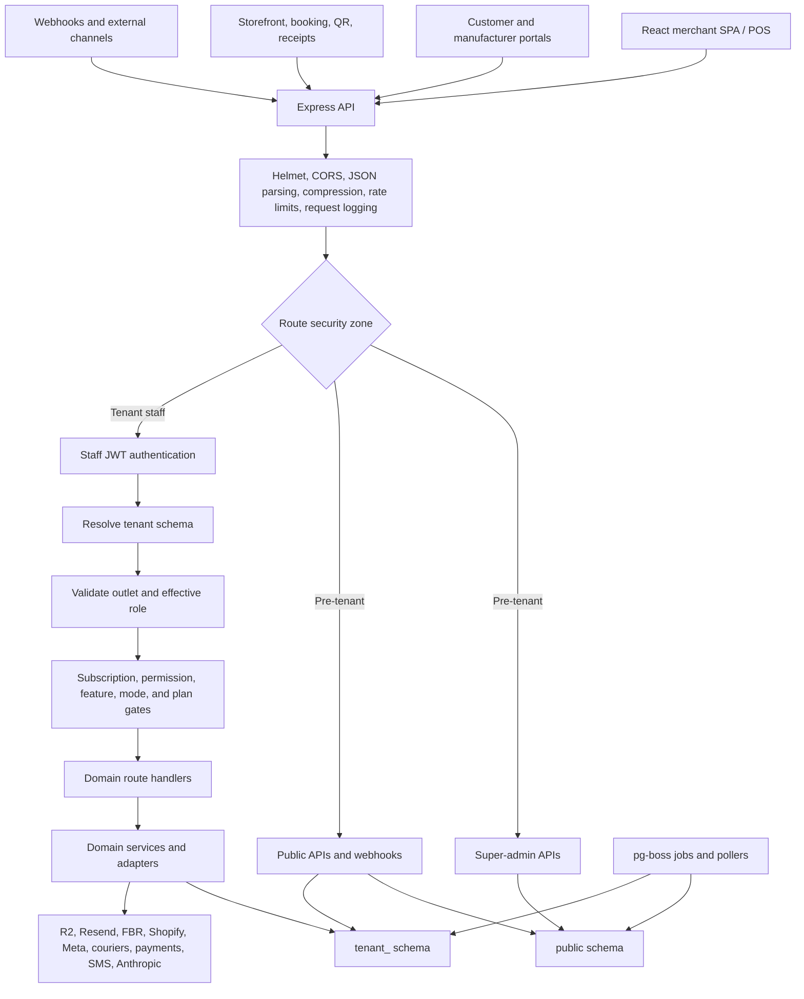
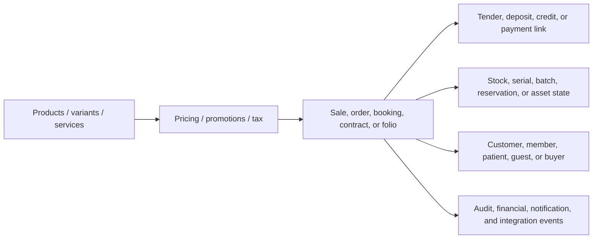

# System Overview and Component Architecture

## Technology stack

SanoPOS is a split-host modular monolith:

| Layer | Implementation |
|---|---|
| Backend runtime | Node.js 22, CommonJS |
| Web framework | Express 5.2 |
| Frontend | React 19.2 |
| Routing | React Router 7.13 |
| Build tooling | Vite 7.3 |
| Styling | Tailwind CSS 4 plus CSS design tokens |
| Database | PostgreSQL through `pg` |
| Tenant isolation | PostgreSQL schema per tenant |
| Background work | pg-boss plus in-process pollers |
| Object storage | Cloudflare R2 with local fallback |
| Backend hosting | Docker on Railway |
| Frontend hosting | Vercel |
| Logging | Pino and pino-http |
| Error tracking | Sentry |
| AI provider | Anthropic Claude |

The dependency manifests are [`backend/package.json`](../../../backend/package.json#L1) and [`frontend/package.json`](../../../frontend/package.json#L1).

There is no ORM. Domain code executes parameterized SQL directly and makes extensive use of PostgreSQL transactions, row locks, JSONB, partial indexes, exclusion constraints, catalog queries, and schema-qualified access.

## Component diagram

## Runtime shape

The backend is one Node process. It:

1. Loads environment configuration.
2. Initializes Sentry when configured.
3. Creates the PostgreSQL and multi-tenant infrastructure.
4. Constructs the Express middleware chain.
5. Registers super-admin, public, webhook, and tenant routes.
6. Starts listening.
7. Starts pollers and pg-boss workers.

This sequence is visible in [`backend/index.js`](../../../backend/index.js#L1). Worker startup occurs after the HTTP server begins listening at [`backend/index.js`](../../../backend/index.js#L308).

The route graph is highly modular at the file level but deployed as a single application. Most domain modules export a registration function that receives `app` and a shared `deps` object. The central registration order is visible in [`backend/routes/registerAllRoutes.js`](../../../backend/routes/registerAllRoutes.js#L471).

## Core architectural spine

Most specialized verticals reuse the same underlying spine:

Examples:

- Restaurant checks become sales while retaining table, seat, course, modifier, and server context.
- Appointment checkout links a sale back to the appointment and performed service.
- Room and treatment charges can be posted to folios rather than paid immediately.
- Wholesale credit sales create accounts-receivable invoices.
- Storefront checkout creates web orders, allocations, reservations, and payment sessions.
- Rental and service workflows reuse customer, deposit, product, payment, notification, and document infrastructure.

## Major application surfaces

The system has four distinct authenticated surfaces and several public surfaces:

1. **Merchant staff application**
   - Dashboard, settings, POS, reports, and vertical workflows.
   - Staff JWT or trusted single-tenant employee header.

2. **Super-admin application**
   - Platform tenant lifecycle, billing, support, monitoring, backup, migrations, and security.
   - Separate admin login, TOTP, and refresh-session flow.

3. **Customer portal**
   - Invoices, payments, appointments, treatments, stays, packages, subscriptions, contracts, tickets, orders, loyalty, wallet, forms, and galleries.
   - Customer-scoped JWT.

4. **Manufacturer portal**
   - Brand-scoped onward sales and promotion/scheme data.
   - Manufacturer-scoped JWT.

Public browser surfaces include the marketing site, signup, setup, receipts, gift-card lookup, storefront, booking engines, restaurant menu, pay-at-table, reservations, forms, inquiries, and member check-in.

## Architectural characterization

SanoPOS should be understood as a configurable business platform rather than a collection of unrelated feature pages. Its principal architectural mechanisms are:

- Schema-per-tenant isolation
- Raw PostgreSQL transactions and ledgers
- Staff RBAC with per-outlet roles
- Tenant and outlet context
- Industry presets
- Modes
- Feature flags
- Business Module cards
- Background jobs
- External adapter patterns
- Shared POS and order-processing infrastructure

