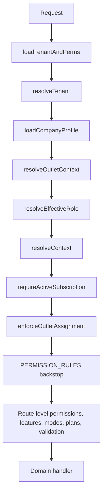

# Backend Runtime, Request Lifecycle, PostgreSQL, and Tenancy

## Global Express middleware

The global middleware chain is created in [`backend/index.js`](../../../backend/index.js#L114):

1. Helmet
2. CORS
3. `express.json` with a 10 MB limit
4. Raw-body capture for signed webhook URLs
5. Malformed JSON conversion to HTTP 400
6. Global static upload serving
7. Optional R2 proxy
8. Compression
9. Cookie parsing
10. Global rate limiting
11. Request ID and structured HTTP logging

Helmet explicitly disables content security policy and cross-origin embedder policy. CORS accepts a configured comma-separated list of origins and enables credentials.

Raw request bodies are retained for:

- `/api/webhooks/*`
- `/api/integrations/shopify/webhooks/*`

This allows HMAC verification over the exact bytes received.

## Route security zones

### Pre-tenant routes

These routes are mounted before normal staff authentication and tenant resolution:

- Health checks
- Super-admin routes
- Payment and marketplace webhooks
- Sandbox payment simulation
- Public receipts and gift cards
- Storefront
- Restaurant QR ordering
- Pay-at-table
- Public reservations
- Appointment booking
- Rental and room booking
- Public forms and inquiries
- Member check-in kiosk
- Customer portal
- Manufacturer portal
- Setup wizard
- Country packs

The registration order is visible at the start of [`registerAllRoutes.js`](../../../backend/routes/registerAllRoutes.js#L52).

Public tenant-bound routes use [`resolvePublicTenantDb`](../../../backend/services/public-tenant-context.js#L7), which accepts a tenant slug from the query string or `x-tenant-slug`, checks that the tenant is active in the public registry, and returns a tenant-scoped database handle.

### Authenticated tenant routes

The tenant request chain begins at [`registerAllRoutes.js`](../../../backend/routes/registerAllRoutes.js#L236):



The company profile is cached for five minutes per tenant. Feature, mode, outlet, and context-policy caches use shorter in-process TTLs.

## PostgreSQL pool

[`backend/db-pg.js`](../../../backend/db-pg.js#L13) creates a `pg.Pool` with:

- `DATABASE_URL`
- Pool maximum of 20
- Production SSL with `rejectUnauthorized: false`
- Query, transaction, client checkout, and shutdown helpers

The base transaction helper executes `BEGIN`, invokes the callback, commits on success, rolls back on failure, and always releases the client.

## Schema-per-tenant routing

In multi-tenant mode, the public schema holds platform data while each merchant receives:

```text
tenant_<slug>
```

The active request database is exposed through an `AsyncLocalStorage` proxy in [`tenant-db-proxy-pg.js`](../../../backend/tenant-db-proxy-pg.js#L10). Route handlers can capture a shared `db` object at boot while each call is redirected to the database handle in the current async context.

[`tenant-db-manager-pg.js`](../../../backend/tenant-db-manager-pg.js#L27) resolves the tenant through the public registry and builds a scoped database object.

For ordinary queries it:

1. Checks out a pool client.
2. Begins a transaction.
3. Executes `SET LOCAL search_path TO tenant_<slug>, public`.
4. Executes the query.
5. Commits or rolls back.
6. Releases the client.

This is specifically designed for transaction-mode poolers, where a standalone `SET search_path` and later query could otherwise execute on different backend connections.

Tenant registry rows are cached for 60 seconds. Suspended and deleted tenants are rejected before a scoped handle is returned.

## Public schema access

[`master-db-pg.js`](../../../backend/master-db-pg.js#L1) owns public registry access. Its queries also use:

```sql
BEGIN;
SET LOCAL search_path TO public;
-- query
COMMIT;
```

The public schema contains or is extended to contain:

- Tenants
- Super-admins
- Tenant audit log
- Tenant refresh tokens
- Plan pricing
- Payment records
- Upgrade requests
- Payment intents
- Impersonation sessions
- Admin sessions and security data
- Platform Module locks
- Lifecycle/adoption and infrastructure cache data

## Tenant provisioning

[`tenant-provisioner-pg.js`](../../../backend/tenant-provisioner-pg.js#L45) provisions tenants as follows:

1. Validate a three-to-forty-character lowercase slug.
2. Create `tenant_<slug>`.
3. Start one tenant-schema transaction.
4. Set the local search path.
5. Apply the complete schema.
6. Seed all migration versions into `schema_version`.
7. Create the initial outlet.
8. Create the Administrator role and permissions.
9. Create the Administrator employee.
10. Assign the employee to the outlet.
11. Create `company_profile` with a 48-hour setup token.
12. Seed a zero-percent default tax.
13. Commit.
14. Register the tenant and audit entry in the public schema.

Schema creation is intentionally outside the main transaction. If later work fails, the provisioner attempts `DROP SCHEMA ... CASCADE`. Orphan-schema scanning is the recovery mechanism when cleanup also fails.

## Setup completion

The setup wizard finalizes the tenant in one transaction in [`backend/routes/setup.js`](../../../backend/routes/setup.js#L192). It applies:

- Company identity and country settings
- Currency and timezone
- Tax mode
- Industry preset
- Full mode-row set
- Mode-related flags
- Preset-specific flags
- Country compliance availability
- Default outlet
- Administrator, Manager, and Cashier roles
- Default permissions
- Administrator employee
- Receipt template
- Optional tax
- Sequence repair after explicit seed IDs
- `setup_complete = true`

In multi-tenant mode, setup can return an automatically minted staff access/refresh session after successful completion.

## Migrations

[`backend/migrate-pg.js`](../../../backend/migrate-pg.js#L10020) applies migrations sequentially inside transactions.

Deployment migration order is:

1. Public schema
2. Public-schema RLS sweep
3. Every active tenant schema

Every schema maintains its own `schema_version`.

Public migration failure is fatal. A tenant migration failure is logged and the runner continues to the next tenant. This improves deployment availability but allows tenant schema versions to diverge until repaired.

## Manual-client isolation concern

The normal query and transaction paths use `SET LOCAL`, which resets automatically.

The manual `getClient()` path in [`tenant-db-manager-pg.js`](../../../backend/tenant-db-manager-pg.js#L89) instead applies a session-level search path and returns the raw client. Import routes acquire such clients and release them directly, for example [`backend/routes/import.js`](../../../backend/routes/import.js#L333).

Unlike [`workers/tenant-job-context.js`](../../../backend/workers/tenant-job-context.js#L48), this path does not automatically restore `search_path` to `public` before release.

Recommended hardening:

- Return a wrapped client whose `release()` resets the search path.
- Or replace manual client use with a tenant-scoped transaction callback.
- Add an integration test that releases a tenant client and verifies the next raw pool checkout resolves `current_schema()` as `public`.

