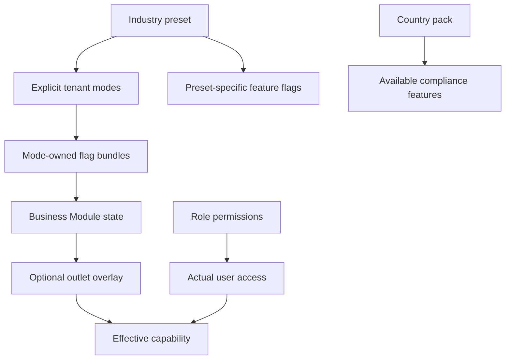

# Authentication, Authorization, Configuration, and Security

## Staff JWT authentication

Staff token utilities are defined in [`backend/jwt-auth.js`](../../../backend/jwt-auth.js#L12).

An access token carries:

- Tenant ID
- Employee ID
- Role ID
- Outlet ID
- Scope
- JTI

Refresh tokens carry tenant and employee identity plus `type: "refresh"`. Only their SHA-256 hashes are stored in the database.

The multi-tenant login, refresh, context update, logout, password reset, signup, email verification, and session endpoints are in [`backend/routes/auth.js`](../../../backend/routes/auth.js#L296).

### Login

Multi-tenant login:

1. Resolves tenant by slug.
2. Opens a tenant-scoped database.
3. Finds the employee.
4. Validates password or bcrypt PIN.
5. Loads current permissions.
6. Chooses a default outlet.
7. Signs an access token.
8. Signs and stores a refresh token hash.
9. Sets the refresh token as an HTTP-only cookie.

### Refresh rotation

Refresh is single-use:

- The presented hash must exist.
- A previously revoked token is treated as probable token reuse.
- Reuse revokes all active refresh tokens for that employee and tenant.
- Successful refresh creates a replacement token before revoking the old row.
- The new access token preserves the current outlet context.

### Revocation

Staff access tokens are checked against:

- `revoked_tokens.token_jti`
- `employees.tokens_revoked_before`
- Revoked impersonation sessions

Permissions and the employee’s current base role are read from the database on every request, so role edits take effect without waiting for JWT expiry.

## Single-tenant mode

[`loadEmployeePerms`](../../../backend/middleware/tenant-auth.js#L55) trusts `x-employee-id` and loads that employee’s permissions. It does not authenticate a session.

This is a compatibility/development mode and should only be used in a trusted environment. Multi-tenant JWT mode is the appropriate public deployment configuration.

## Super-admin authentication

The super-admin flow is implemented in [`backend/routes/admin/auth.js`](../../../backend/routes/admin/auth.js#L50).

It supports:

- Password login
- Optional TOTP challenge
- One-time recovery codes stored as bcrypt hashes
- One-hour access tokens
- Seven-day rotating refresh sessions
- Refresh-token hashes in `admin_sessions`
- Refresh-token reuse detection
- Active-session listing
- Revocation of other sessions
- Security event logging

TOTP helpers live in [`backend/services/admin-totp.js`](../../../backend/services/admin-totp.js#L1). TOTP secrets are stored in recoverable form because verification requires the original shared secret; recovery codes are individually hashed and burned after use.

Super-admin routes are mounted before tenant middleware and query the public schema.

## Customer portal authentication

[`backend/middleware/customer-auth.js`](../../../backend/middleware/customer-auth.js#L1) implements customer JWT scope.

Tokens include:

- Customer ID
- Tenant ID and slug
- `scope: "customer"`
- JTI

Portal middleware:

- Rejects refresh tokens as access tokens.
- Resolves the tenant independently.
- Cross-checks token tenant against the resolved tenant.
- Rejects deleted customers.
- Applies a per-customer token revocation cursor.

The portal has its own OTP, password-reset, refresh-token, and payment flows.

## Manufacturer portal authentication

[`backend/middleware/manufacturer-auth.js`](../../../backend/middleware/manufacturer-auth.js#L1) uses the parallel `manufacturer` scope.

It additionally:

- Rejects suspended partners.
- Requires active partner status.
- Applies a per-partner token revocation cursor.
- Restricts data through manufacturer/brand relationships.

## Portal-secret configuration risk

Customer and manufacturer portal secrets can be configured independently:

- `CUSTOMER_PORTAL_JWT_SECRET`
- `MANUFACTURER_PORTAL_JWT_SECRET`

Both fall back to `JWT_SECRET`. If that is also absent, they fall back to the literal `dev-insecure-secret`.

Production configuration should make all JWT secrets mandatory and fail startup when they are missing.

## Role-based access control

The central catalog contains 39 permission IDs in [`backend/config/permissions-catalog.js`](../../../backend/config/permissions-catalog.js#L23).

Permission categories include:

- System and delegation
- Catalog and inventory
- Orders and returns
- Customers
- Five report data classes
- Finance and report administration
- POS actions
- Manager overrides
- Restaurant
- Service verticals
- Gift cards
- Wholesale field sales

Authorization layers include:

1. Route-level `requirePerm`
2. Route-level `requireAnyPerm`
3. Declarative `PERMISSION_RULES` backstop
4. Employee-to-outlet assignment
5. Per-outlet role override
6. Frontend visibility and route guards

Backend authorization is authoritative. Frontend permission checks only control navigation and presentation.

## Outlet context and per-outlet roles

[`backend/middleware/outlet-context.js`](../../../backend/middleware/outlet-context.js#L110) defines outlet precedence:

```text
validated x-outlet-id header
→ valid JWT oid claim
→ no outlet
```

Validation includes:

- Positive integer format
- Active outlet existence
- Employee assignment
- Special tenant-wide treatment for field representatives

The resolver also reads `employee_outlets.role_id`.

[`resolveEffectiveRole`](../../../backend/middleware/tenant-auth.js#L349) preserves the employee’s base permissions, then replaces effective permissions for the current request when the outlet assignment has an override role.

Base permissions remain responsible for outlet reach. Therefore, a more powerful outlet role cannot grant access to an outlet the employee was never assigned.

## Presets, modes, flags, and Business Modules

Configuration is layered:



### Industry presets

[`industry-config.js`](../../../backend/config/industry-config.js#L1) defines 23 presets. They change:

- Terminology
- POS layout mode
- Unit vocabulary
- Dashboard widgets
- Onboarding steps
- Report visibility
- Enabled modes
- Clinical and portal behavior

### Modes

[`mode-registry.js`](../../../backend/config/mode-registry.js#L1) defines ten modes:

- Restaurant
- Appointments
- Commissions
- Service projects
- Subscriptions
- Workflow tickets
- Rentals
- Room management
- Treatment plans
- Wholesale

Every tenant is expected to have an explicit row for every mode. Missing mode rows cause mode-gated routes to fail closed.

### Feature flags

[`feature-flags.js`](../../../backend/middleware/feature-flags.js#L24) contains more than 100 defaults. Flags are cached per tenant for 60 seconds.

Feature gates return HTTP 403 when disabled. Mode gates return:

- HTTP 403 when the requested mode is off.
- HTTP 403 with `MODES_NOT_SEEDED` when the tenant has no mode rows.

### Business Modules

[`business-modules.js`](../../../backend/config/business-modules.js#L96) defines 49 merchant-facing cards:

- 11 vertical modules
- 29 operational modules
- 9 connection/setup modules

The catalog supports:

- Dependencies
- Platform locks
- Impact queries
- Setup checklists
- Connection checks
- Configuration snapshots on disable
- Per-outlet defaults and overrides
- Permission relationships

The effective outlet rule is:

```text
company enabled
AND
(explicit outlet override ?? tenant module default ?? true)
```

## Security controls

Implemented controls include:

- Helmet headers
- CORS allowlist
- Request size limits
- Raw-body webhook verification
- Global and endpoint-specific rate limits
- Parameterized SQL
- Zod validation
- JWT scopes
- Refresh-token hashing and rotation
- JTI and blanket token revocation
- TOTP for super-admins
- Upload MIME and extension validation
- Magic-byte image verification
- SVG exclusion on sensitive upload paths
- AES-256-GCM integration-secret encryption
- Public-schema RLS
- Request IDs
- Audit and security logs
- Sentry exception capture

## Security limitations

### Content Security Policy

Helmet CSP is disabled in [`backend/index.js`](../../../backend/index.js#L114), and the Vercel header configuration does not add one.

### Integration encryption fails open

[`encryptSecret`](../../../backend/services/crypto.js#L20) returns plaintext when no integration encryption key exists. Production should require `INTEGRATION_SECRET_KEY`.

### Rate limiting is process-local

No distributed rate-limit store is configured in [`backend/middleware/rate-limit.js`](../../../backend/middleware/rate-limit.js#L55). Limits reset on restart and are not coordinated across replicas.

### Daraz webhook

The Daraz webhook is not currently signature-verified. See [`backend/routes/webhooks.js`](../../../backend/routes/webhooks.js#L781).

### Access token storage

The staff access token is stored in localStorage through [`frontend/src/auth/authStore.js`](../../../frontend/src/auth/authStore.js#L14). The refresh token is protected by an HTTP-only cookie, but an XSS vulnerability could still read the current access token.

