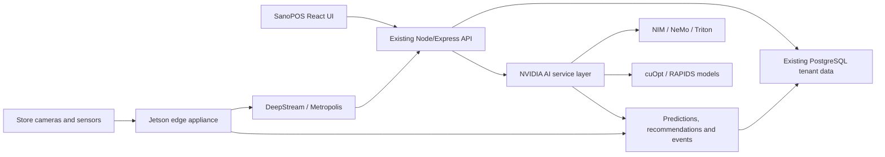

# NVIDIA AI Research Conversation for SanoPOS

Date: 2026-07-08  
Status: Research only; no application functionality was changed during this conversation.  
Scope: Complete visible user-assistant NVIDIA discussion, beginning with the NVIDIA infrastructure research request. Hidden system instructions, tool-call internals, and secrets are intentionally excluded.

---

## 1. Exploring NVIDIA infrastructure for SanoPOS

### User

> https://www.nvidia.com/en-us how can we use nvidia infrastructure to our advantage for our software we are developing, what can we do with it explore each and every scenario this to our advantage. This is only for research purpose, dont add or remove anything from the app.

### Assistant

NVIDIA can benefit SanoPOS substantially—but mainly as an AI/edge-computing layer beside the existing application, not as a replacement for Railway, Vercel, Node.js, or PostgreSQL.

I made no changes to the application or repository.

## Bottom line

The strongest opportunities are:

1. AI analytics and business copilot.
2. Invoice, GRN, receipt, and catalog document extraction.
3. Demand forecasting and replenishment.
4. Delivery and fulfillment optimization.
5. Store-camera loss prevention and checkout verification.
6. Shopping assistants for storefront and WhatsApp.
7. Edge AI appliances for stores with unreliable internet.
8. NVIDIA’s startup program, training, and cloud credits.

Buying a DGX server or permanently running expensive GPUs would be premature. Start with hosted APIs or short-lived cloud GPUs and prove one measurable use case first.

## How NVIDIA would fit SanoPOS



The AI layer should receive narrowly scoped tenant data and return predictions, extracted fields, alerts, or explanations. It should never directly control payments, inventory, FBR submissions, refunds, or accounting without server-side validation and user confirmation.

## Practical opportunities

### 1. Upgrade the existing AI Insights feature

SanoPOS currently has an AI chat endpoint backed by Anthropic. NVIDIA does not have to replace it immediately.

Possible uses:

- “Why did margin fall this week?”
- “Which outlet is likely to stock out?”
- “Summarize today’s exceptions.”
- “Compare employee refund activity.”
- “Draft a purchase order based on current stock.”
- “Explain the FBR queue failures.”
- “Which products should be transferred between outlets?”
- “Summarize outstanding supplier liabilities.”

NVIDIA NIM supplies optimized, containerized inference services that can run through hosted endpoints or on your own GPU infrastructure. This becomes valuable when inference volume, privacy, latency, or model-control requirements justify self-hosting. NVIDIA says NIM can move between hosted and self-hosted deployment while maintaining standard APIs. [NVIDIA NIM](https://www.nvidia.com/en-us/ai-data-science/products/nim-microservices/)

Recommendation: keep the existing provider while building a provider-neutral AI gateway. Benchmark NIM only after measuring current query volume, response quality, latency, and cost.

### 2. A grounded SanoPOS knowledge assistant

Using NeMo Retriever, SanoPOS could index:

- Product catalogs and descriptions.
- Internal help documentation.
- Support-ticket resolutions.
- Employee SOPs.
- FBR operating guides.
- Supplier catalogs.
- Courier service rules.
- Tenant-specific policies.
- Restaurant recipes and preparation instructions.
- Hotel procedures and room information.
- Rental and service documentation.

NeMo Retriever supports extracting and retrieving text, tables, charts, and images. That makes it more useful than a plain text chatbot for invoices, manuals, catalogs, and operational documents. [NeMo Retriever](https://docs.nvidia.com/nemo/retriever/)

Each tenant must have its own index or strictly enforced tenant filters. Retrieved material should include source references so users can verify answers.

### 3. Storefront and WhatsApp shopping advisor

NVIDIA publishes a retail shopping-advisor workflow using NIM, retrieval, a vector database, and a product catalog. [Retail Shopping Advisor](https://www.nvidia.com/en-sg/ai-data-science/ai-workflows/retail-shopping-advisor/)

SanoPOS could offer:

- Natural-language product search.
- “Show me alternatives below Rs 5,000.”
- Product comparisons.
- Compatibility and sizing questions.
- Dietary or ingredient filters.
- Bundles and complementary products.
- Availability by outlet.
- Personalized recommendations based on consented purchase history.
- Image-based product search.
- WhatsApp product assistance.
- Employee-assisted selling inside POS.

This is most useful for tenants with meaningful product catalogs and online orders. It offers little value to very small stores with 100 simple products.

### 4. Intelligent document processing

This is one of the best near-term pilots.

Possible inputs:

- Supplier invoices.
- Purchase orders.
- GRNs.
- Expense receipts.
- Delivery notes.
- Product catalogs.
- Contracts.
- Hotel guest documents.
- Rental agreements.
- FBR-related documents.

The system could extract:

- Supplier identity and invoice number.
- SKU, description, quantity, unit cost, discount and tax.
- Batch and expiry information.
- Serial numbers.
- Payment terms.
- PO-to-invoice discrepancies.
- Suggested product mappings.

Every extracted field should enter a review screen before being posted. Exact totals, tax, SKU matching, and duplicates should be validated deterministically.

### 5. Loss prevention at checkout

This is NVIDIA’s most directly relevant retail workflow. NVIDIA provides a retail loss-prevention reference workflow that compares visual product recognition with barcode scans and supports few-shot learning for new products. [Retail Loss Prevention Workflow](https://www.nvidia.com/en-gb/ai-data-science/ai-workflows/retail-loss-prevention/)

Potential alerts:

- Product visible but not scanned.
- Barcode does not match the visible item.
- Quantity mismatch.
- Expensive item entered as a cheaper product.
- Item bypassing the scanner.
- Suspicious void/refund combined with camera evidence.
- Unusual till-opening activity.

SanoPOS already has transactional anomaly and employee-risk data. Combining those signals with camera events could produce far stronger evidence than either source alone.

This is not a quick software-only feature. It needs cameras, product-image data, calibration, false-positive testing, privacy controls, retention rules, and usually an experienced vision partner.

### 6. Shelf and inventory vision

Cameras or handheld devices could detect:

- Empty shelf positions.
- Products placed in the wrong location.
- Low facing counts.
- Unreadable or missing price labels.
- Damaged packaging.
- Stockroom quantities.
- Expiry dates and batch codes.
- Warehouse picking mistakes.

NVIDIA DeepStream provides GPU-accelerated video ingestion, multi-stream processing, tracking, and image understanding for retail and other environments. [DeepStream SDK](https://developer.nvidia.com/deepstream-sdk)

A sensible first pilot is a controlled stockroom or one high-value shelf—not whole-store autonomous inventory.

### 7. Queue, traffic, and store-layout analytics

With anonymized video analytics:

- Count entries and exits.
- Estimate checkout queue length.
- Alert when another counter should open.
- Measure dwell time by zone.
- Compare store traffic against conversion.
- Identify congestion.
- Evaluate merchandising layouts.
- Estimate restaurant table occupancy.
- Monitor warehouse dock activity.

Avoid facial recognition or persistent identity tracking unless there is a compelling, legally reviewed requirement. Anonymous counts and event metadata usually provide most of the business value with much less risk.

### 8. Edge AI using Jetson

A Jetson device at a store could:

- Process CCTV feeds locally.
- Recognize products at checkout.
- Read labels and expiry dates.
- Operate when the internet is unavailable.
- Send only alerts and metadata to SanoPOS.
- Avoid continuously uploading raw video.
- Run a small local assistant or speech model.
- Integrate with cameras, scales, sensors, and displays.

Jetson Orin ranges from lower-power Orin Nano systems through higher-performance AGX Orin devices. NVIDIA positions Jetson for edge vision, speech, robotics, retail, and logistics. [Jetson Orin](https://www.nvidia.com/en-us/autonomous-machines/embedded-systems/jetson-orin/)

For multiple deployed devices, Fleet Command can centrally provision and update containerized edge applications. [NVIDIA Fleet Command](https://www.nvidia.com/en-us/data-center/products/fleet-command/faq/)

A Jetson should be treated as an optional store appliance. The browser-based POS must continue working without it.

### 9. Better demand forecasting

SanoPOS currently uses moving-average demand forecasting. GPU-based ML could eventually account for:

- Day of week and season.
- Ramadan, Eid, weddings, holidays, and regional events.
- Outlet-specific patterns.
- Promotions and price changes.
- Stockouts that distorted historical demand.
- Product substitution.
- Weather.
- Supplier lead time.
- Marketplace sales.
- Restaurant wastage.
- Room occupancy.
- Appointment cancellations.

Outputs could include:

- Forecast by SKU/outlet/day.
- Confidence interval.
- Stockout probability.
- Suggested reorder quantity.
- Suggested transfer.
- Safety stock.
- Expiry-risk warning.

RAPIDS provides GPU-accelerated data preparation, analytics, and machine-learning workflows. It becomes attractive only after the data becomes too large or model experimentation too slow for ordinary CPU pipelines. [NVIDIA RAPIDS](https://developer.nvidia.com/machine-learning)

For many current SanoPOS tenants, CPU forecasting will remain cheaper. Model quality and clean data matter before GPU speed.

### 10. Fraud and operational anomaly models

The existing z-score anomaly worker could evolve into models considering:

- Refund and void timing.
- Employee, till and outlet patterns.
- Discount combinations.
- No-sale till openings.
- Payment method switching.
- Repeated customer/product combinations.
- Inventory adjustments after shifts.
- Returns without matching historical behavior.
- Webhook and payment anomalies.
- Tenant account abuse.
- Suspicious login or API behavior.

Triton can serve PyTorch, TensorFlow, ONNX, TensorRT and tree-based models while batching requests to improve GPU utilization. [NVIDIA Triton](https://developer.nvidia.com/blog/fast-and-scalable-ai-model-deployment-with-nvidia-triton-inference-server/)

For cybersecurity-scale streaming telemetry, NVIDIA Morpheus exists, but it is likely excessive for SanoPOS today. It becomes relevant only with large event volumes or enterprise customers demanding real-time security analytics. [NVIDIA Morpheus](https://developer.nvidia.com/morpheus-cybersecurity)

### 11. Courier and fulfillment optimization

NVIDIA cuOpt is highly relevant to SanoPOS’s courier, fulfillment, picklist and loadsheet features.

It could optimize:

- Last-mile delivery routes.
- Vehicle capacity.
- COD priority.
- Time windows.
- Driver shifts.
- Pickup-and-delivery constraints.
- Dynamic rerouting.
- Loadsheets.
- Warehouse pick paths.
- Stock transfers between outlets.
- Field technician dispatch.
- Rental delivery and collection.
- Hotel shuttle routes.

cuOpt supports routing, pickup-and-delivery, linear programming and mixed-integer optimization. NVIDIA now documents open-source and self-hosted options. [NVIDIA cuOpt](https://docs.nvidia.com/cuopt/)

This is most valuable for tenants managing dozens or hundreds of stops. For five daily deliveries, a simple mapping service is sufficient.

### 12. Purchasing and stock-allocation optimization

cuOpt or conventional optimization models could determine:

- Which supplier to order from.
- Minimum-order-quantity combinations.
- Container or vehicle capacity.
- Budget allocation.
- Product allocation across outlets.
- Markdown schedules for expiring inventory.
- Production quantities for restaurants or bakeries.
- Employee roster coverage.
- Room and housekeeping scheduling.

These are optimization problems, not necessarily generative-AI problems. An LLM may explain the result, but a constrained solver should calculate it.

### 13. Product recommendations and promotion intelligence

Possible models:

- Frequently bought together.
- Next-best product.
- Customer-specific offers.
- Promotion uplift.
- Coupon-abuse probability.
- Churn risk.
- Customer lifetime value.
- Price elasticity.
- Dead-stock bundles.
- Restaurant upsell recommendations.
- Shopify/storefront recommendations.

Recommendations should respect consent, suppress sensitive inferences, and be evaluated using incremental margin—not merely clicks.

### 14. Voice-driven POS and operations

Riva can support streaming speech recognition and text-to-speech:

- Hands-free product lookup.
- Voice quantity entry.
- Kitchen order entry.
- Warehouse picking instructions.
- Accessibility support.
- Spoken dashboard summaries.
- Support-call transcription.
- Hotel or restaurant concierge.

Riva supports real-time and batch speech pipelines, but language availability varies. Older official matrices include Hindi but do not establish production-quality Urdu support, so Pakistani Urdu and mixed Urdu-English speech would require a dedicated benchmark before planning a product around it. [NVIDIA Riva ASR](https://docs.nvidia.com/deeplearning/riva/archives/2-4-0/user-guide/docs/asr/asr-overview.html)

Voice should never silently finalize a payment, refund, stock adjustment, or FBR submission.

### 15. Multilingual support and content

Models could assist with:

- Urdu and English product descriptions.
- Support-ticket translation.
- Supplier catalog normalization.
- Receipt explanation.
- Marketing copy.
- WhatsApp replies.
- Internal SOP translation.

Exact names, prices, tax values and legal text must remain sourced from structured data. Generated translations need human review for formal or compliance content.

### 16. AI safety for the existing chat feature

NeMo Guardrails can filter user inputs, retrieved content, tool calls and model outputs. It supports content, topic, retrieval and execution controls. [NeMo Guardrails](https://docs.nvidia.com/nemo/guardrails/about-nemo-guardrails-library/overview)

Useful SanoPOS policies include:

- Block cross-tenant retrieval.
- Prevent raw SQL generation from being executed.
- Mask secrets and personal data.
- Reject instructions to bypass permissions.
- Require confirmation for proposed mutations.
- Prevent medical diagnosis in clinical modes.
- Prevent invented tax or FBR rules.
- Force citations to tenant data for numerical claims.

Guardrails help, but ordinary server permissions and tenant isolation remain the real security boundary.

### 17. Synthetic data and store simulation

Omniverse could generate synthetic training data for:

- Product recognition under different lighting and camera angles.
- Checkout-loss scenarios.
- Shelf and warehouse configurations.
- Occlusions and packaging variants.
- Store-layout experiments.
- Robot or autonomous-cart simulations.
- Camera placement testing.

NVIDIA positions Omniverse for simulation, industrial digital twins, robotics, and synthetic-data generation. [NVIDIA Omniverse](https://www.nvidia.com/en-us/omniverse/)

This is a later-stage investment. It becomes valuable if SanoPOS develops a proprietary computer-vision product—not for normal POS development.

## Opportunities by SanoPOS industry

| Industry | Strong NVIDIA scenarios |
|---|---|
| Grocery and general retail | Checkout verification, shelf stock, expiry OCR, demand forecasting, shopping assistant |
| Restaurant | Demand/waste forecasting, voice KDS, kitchen queue analytics, menu recommendations, delivery routing |
| Wholesale and distribution | Route optimization, load planning, warehouse picking, supplier-document extraction |
| Hotel and rooms | Multilingual concierge, occupancy forecasts, housekeeping scheduling, document extraction |
| Rentals | Before/after damage comparison, contract extraction, delivery/collection routing, predictive maintenance |
| Service businesses | Technician dispatch, photo-based inspection, ticket summarization, parts recommendations |
| Clinic/dental | Document summarization and scheduling only; diagnosis or treatment recommendations need much stricter clinical governance |
| E-commerce | Shopping assistant, semantic search, image search, recommendations, catalog enrichment |
| Multi-outlet chains | Allocation, transfers, forecasting, shared GPU inference, fleet-managed edge devices |

## Deployment choices

| Option | Best use | Recommendation |
|---|---|---|
| Hosted NVIDIA APIs | Rapid experiments | Best starting point |
| Temporary cloud GPU | Benchmarks and batch model training | Use only when needed |
| Self-hosted NIM on cloud GPU | Stable, high-volume inference or privacy requirements | Consider after proving economics |
| Jetson in store | Cameras, sensors, offline inference | Strong for vision pilots |
| RTX workstation | Development and small-model experimentation | Reasonable before DGX |
| DGX Spark | Local large-model prototyping and private R&D | Interesting, but not required initially |
| DGX Cloud/DGX servers | Large training or enterprise AI factory | Far beyond current needs |
| AI Enterprise | Supported production NIM/NeMo/vision platform | Consider when enterprise contracts justify support |

DGX Spark provides 128 GB unified memory and is intended for local model inference and development, but it should be bought only for a sustained workload—not because it is an appealing little black AI monolith. [DGX Spark](https://www.nvidia.com/en-us/products/workstations/dgx-spark/)

NVIDIA AI Enterprise production licensing is generally per GPU or cloud consumption, with production support and longer-lived software branches. [AI Enterprise licensing](https://docs.nvidia.com/ai-enterprise/planning-resource/licensing-guide/latest/licensing.html)

## Multi-tenant design requirements

SanoPOS’s live multi-tenancy makes these non-negotiable:

- Separate or strongly filtered retrieval indexes per tenant.
- Tenant ID applied before retrieval, not after generation.
- No model training on customer data without explicit agreement.
- Encrypt documents and embeddings.
- Store model version, prompt version and source records.
- Audit every AI-proposed action.
- Preserve normal permissions and subscription limits.
- Never place database credentials in prompts.
- Send the minimum required fields.
- Set deletion and retention policies for embeddings, documents, audio and video.
- Human approval for financial, inventory, tax and employee-risk actions.
- Separate camera metadata from raw footage.
- Benchmark models across Pakistani names, products, accents and mixed-language input.

If a shared enterprise GPU is eventually used, NVIDIA MIG can partition supported GPUs into isolated instances. That is useful for predictable workload isolation, but it does not replace application-level tenant controls. [NVIDIA MIG](https://www.nvidia.com/en-eu/technologies/multi-instance-gpu/)

## What should not move to NVIDIA GPUs

Do not move these simply for “acceleration”:

- PostgreSQL transactional queries.
- Express API routes.
- Authentication and JWT verification.
- Receipt generation.
- Ordinary report SQL.
- Webhook processing.
- Email workers.
- FBR queue processing.
- Vite builds.
- Small CSV imports.
- Simple forecasting for small datasets.
- Small-route optimization problems.

These workloads are inexpensive and appropriate on CPUs. A GPU that spends most of its time idle is not infrastructure leverage; it is an unusually warm invoice.

## Recommended research roadmap

### Phase 1: Free or low-cost experiments

1. Apply to [NVIDIA Inception](https://www.nvidia.com/en-us/startups/). The program is free and offers training, partner offers, preferred pricing and possible cloud credits.
2. Prototype NIM on anonymized SanoPOS analytics questions.
3. Test document extraction on 100 real, redacted supplier invoices.
4. Benchmark Urdu, English and mixed-language requests.
5. Test cuOpt with historical delivery routes.
6. Compare quality, latency and estimated cost against the existing approach.

### Phase 2: Three measurable pilots

Run only these initially:

- Invoice/GRN extraction.
- AI analytics with grounded database results.
- Demand forecast or route optimization.

Suggested success gates:

| Pilot | Minimum evidence |
|---|---|
| Document extraction | At least 98% accuracy on financial totals and materially less manual entry |
| Analytics assistant | No cross-tenant leakage; numerical answers traceable to source queries |
| Forecasting | Lower WAPE and demonstrable reduction in stockouts or waste |
| Routing | Reduced kilometers, fuel cost, planning time or late deliveries |
| Vision | Acceptable false-alert rate and clear shrink reduction |

### Phase 3: One-store edge pilot

Only after the software pilots:

- One Jetson device.
- One or two existing cameras.
- One checkout lane or stockroom zone.
- Metadata-only cloud integration.
- Staff review of every alert.
- Fixed 60–90 day measurement period.

### Phase 4: Production decision

Move to self-hosted NIM, Triton, AI Enterprise, or a managed GPU platform only when measurements show:

- Predictable sustained inference load.
- Material API-cost savings.
- Privacy or residency requirements.
- Latency that hosted APIs cannot meet.
- Enterprise customers willing to pay for the capability.
- A team able to operate GPU containers, observability, model updates and fallbacks.

The highest-return starting point for SanoPOS is therefore not purchasing hardware. It is using NVIDIA’s hosted development access and startup benefits to validate document intelligence, grounded analytics, and route optimization—then using Jetson and DeepStream only if SanoPOS chooses to become a serious retail computer-vision platform.

---

## 2. NVIDIA Inception availability and low-cost experiments

### User

> Is NVIDIA Inception available in US only or can a Pakistan business also apply? Also I would like to start out from free or low cost experiments. How can we proceed?

### Assistant

Yes—a Pakistan-incorporated business can apply. NVIDIA Inception is global, not US-only. The official eligibility criteria do not exclude Pakistan.

You generally qualify if SanoPOS:

- Is officially incorporated.
- Is under 10 years old.
- Has at least one developer.
- Has a working business website.
- Is a product startup—not primarily an outsourcing/consulting company, reseller, cloud provider, cryptocurrency company, or public company.

There are no application fees, membership fees, equity requirements, funding requirements, or revenue requirements. Approval remains NVIDIA’s decision, and individual benefits or cloud-credit offers can vary by region. [NVIDIA Inception eligibility and application](https://www.nvidia.com/en-us/startups/)

## How I recommend proceeding

### Step 1: Create a free NVIDIA Developer account

Join the [NVIDIA Developer Program](https://developer.nvidia.com/developer-program).

This is separate from Inception and gives access to:

- NVIDIA-hosted NIM APIs for prototyping.
- NIM containers for development and testing.
- Developer tools and documentation.
- Forums.
- Some free Deep Learning Institute training.

NVIDIA currently offers hosted NIM endpoints for prototyping within trial limits. [NIM for Developers](https://developer.nvidia.com/nim)

Do this first because access is normally immediate, whereas Inception requires an application review.

### Step 2: Apply to NVIDIA Inception

Prepare:

- Registered company name.
- Incorporation country: Pakistan.
- Incorporation date.
- Company website.
- Business-domain email address.
- Founder/business contact.
- Developer/technical contact.
- Team size and funding stage.
- Short product description.
- Pitch deck.

Position SanoPOS clearly as:

> A multi-tenant SaaS product platform for retail, restaurants, hospitality and service businesses, with inventory, payments, fulfillment, e-commerce integrations, Pakistani tax compliance and an AI/edge-computing roadmap.

Avoid presenting the company as an outsourced software-development service. That category is explicitly ineligible.

### Suggested pitch-deck structure

Keep it to approximately 10 slides:

1. SanoPOS vision.
2. Problems faced by Pakistani and emerging-market merchants.
3. Current product.
4. Supported industries and workflows.
5. Market opportunity.
6. Product architecture and multi-tenancy.
7. Existing traction or development progress.
8. NVIDIA opportunity: insights, documents, forecasting, routing and retail vision.
9. Business model and go-to-market.
10. Team and what you want from Inception.

Potential request:

> We want NVIDIA technical guidance, training and cloud-compute support to evaluate NIM-based business intelligence, cuOpt delivery optimization, document intelligence and Jetson-based retail loss prevention.

## Zero-cost experiment plan

Do not connect the production application initially. Experiments should use synthetic or anonymized datasets outside live tenant databases.

### Experiment 1: NVIDIA NIM analytics

Objective: test whether an NVIDIA-hosted model can power SanoPOS AI Insights.

Prepare:

- 30–50 anonymized sales summaries.
- Inventory and outlet summaries.
- 25 representative business questions.
- Correct expected answers.

Test questions such as:

- Which products are likely to stock out?
- Why did gross margin decline?
- Which outlet had unusual refunds?
- Suggest an inter-outlet stock transfer.
- Summarize supplier liabilities.
- Explain today’s FBR failures.

Measure:

- Numerical correctness.
- Hallucination rate.
- Response time.
- Urdu/English handling.
- Quality compared with the current Anthropic-backed feature.
- Estimated cost at 100, 1,000 and 10,000 questions per month.

Spending cap: **Rs 0** using free prototype endpoints.

### Experiment 2: cuOpt delivery routing

NVIDIA exposes an interactive cuOpt trial and API example for last-mile delivery. [Try NVIDIA cuOpt](https://build.nvidia.com/nvidia/nvidia-cuopt)

Prepare anonymized data from 10–30 delivery days:

- Depot location.
- Customer coordinates.
- Delivery time windows.
- Vehicle capacities.
- COD priority.
- Driver availability.
- Existing route distance and duration.

Compare cuOpt’s result with the historical route:

- Total kilometers.
- Estimated duration.
- Vehicles required.
- Late deliveries.
- Planning time.

NVIDIA also offers a free browser-based LaunchPad route-optimization lab, subject to access approval. [cuOpt LaunchPad experiment](https://developer.nvidia.com/blog/experience-nvidia-cuopt-accelerated-optimization-to-boost-operational-efficiency/)

Spending cap: **Rs 0**.

### Experiment 3: Supplier invoice and GRN extraction

Prepare 50–100 redacted documents covering different Pakistani suppliers and layouts.

Extract:

- Invoice number and date.
- Supplier.
- SKU and product description.
- Quantity.
- Unit price.
- Discount.
- Sales tax.
- Total.
- Batch and expiry.
- Payment terms.

Score each field separately. Financial totals should approach 100% after deterministic validation. Anything below roughly 95–98% line-item accuracy is unlikely to save meaningful operator time.

Spending cap: **Rs 0 initially**; optionally allow a small API budget only after the first sample succeeds.

### Experiment 4: Demand forecasting

This experiment does not need a GPU initially.

Use anonymized historical data and compare:

- Current moving average.
- Seasonal CPU model.
- GPU-oriented RAPIDS model later.

Measure:

- Forecast error.
- Stockouts.
- Excess inventory.
- Expiry/wastage.
- Accuracy by product and outlet.

Only rent GPU time if the CPU model becomes too slow or the dataset becomes genuinely large. GPU acceleration cannot rescue poor or insufficient data.

## Suggested four-week sequence

| Week | Work | Cost target |
|---|---|---:|
| 1 | Developer registration, Inception application, sanitized datasets | Rs 0 |
| 2 | NIM analytics benchmark | Rs 0 |
| 3 | cuOpt historical-route benchmark | Rs 0 |
| 4 | Invoice extraction and final comparison | Rs 0–small capped trial |

At the end, score each experiment on:

- Customer value.
- Accuracy.
- Cost per tenant.
- Engineering effort.
- Privacy risk.
- Ability to charge for it.
- Advantage over existing non-NVIDIA options.

Proceed with only the highest-scoring experiment. Do not buy NVIDIA hardware yet; cloud credits, hosted endpoints, and LaunchPad are enough to determine whether there is a real opportunity.

---

## 3. Filling the NVIDIA Developer Program profile

### User

Screenshot supplied: `C:/Users/HP/AppData/Local/Temp/codex-clipboard-d43fb544-d51f-4319-9ba2-cdb5222b3d40.png`

> How should I fill this up for NVIDIA developer account? One Shop the toy store is an incorporated partnership registered company entity, my retail toy business, but SanoPOS is just a pilot software with only a working live website; it is not incorporated. How should I proceed? This is for registration for NVIDIA Developer Program, not Inception.

### Assistant

The NVIDIA Developer Program account is an individual developer profile, not an Inception/company application. You can register using your real affiliation with incorporated One Shop while evaluating NVIDIA technology for the SanoPOS pilot.

Fill it as follows:

- Industry: **Retail**. If unavailable, choose **Consumer Internet**, **E-commerce**, or the closest retail option.
- Job Role: **Business Executive** is accurate if you are an owner/partner. Choose **Founder/Owner** if offered and more accurate.
- Organization Name: Enter the full registered name of **One Shop** exactly as it appears on the partnership registration.
- Organization URL: Use One Shop’s website. If it has no website, leave this optional field blank. Use the SanoPOS URL only if that website clearly states SanoPOS is a software project/product developed or operated by One Shop.
- Language: **English**.
- Location: **Pakistan**.

You do not need to claim that SanoPOS is incorporated. If Step 2 asks about projects or interests, describe it truthfully:

> Developing and evaluating SanoPOS, a pilot multi-tenant retail and point-of-sale software platform operated as an innovation project by One Shop. Exploring NVIDIA NIM, analytics, demand forecasting, document processing and retail optimization.

Choose interests such as:

- Generative AI
- NVIDIA NIM
- Machine Learning
- Data Science
- Retail
- Intelligent Document Processing
- Optimization
- Computer Vision

Your Gmail address is acceptable for the Developer Program. Later, if NVIDIA asks for commercial licensing or an Inception application, clearly state that One Shop is the legal entity and SanoPOS is currently its pilot software project.

---

## 4. Free NVIDIA registrations and services after Developer Program signup

### User

Screenshots supplied:

- `C:/Users/HP/AppData/Local/Temp/codex-clipboard-cdb8eadf-39c3-4960-a03a-1e0ce7c47746.png`
- `C:/Users/HP/AppData/Local/Temp/codex-clipboard-b264abd7-3429-476c-99f0-30c085e85702.png`

> I am on this page now after registering for Developer Program. Also I have access to NIM page. Anything else that I should register or set in NVIDIA website that is free apart from the startup program for now?

### Assistant

You have completed the essential registration. There is no need to register everywhere. Your screenshot shows hosted NIM access with a free-endpoint limit of up to 40 requests per minute—plenty for research.

## Do these now

1. Click **Get API Key** on the NIM page.

Name it something like:

`sanopos-research`

Important:

- Copy it once into a password manager.
- Never show it in screenshots or chat.
- Never place it in React/frontend code.
- Eventually it belongs in a server-side environment variable.
- Do not commit it to Git.
- Use only anonymized or synthetic business data during trials.

The hosted endpoints are for development and prototyping, not production. [NVIDIA NIM FAQ](https://forums.developer.nvidia.com/t/nvidia-nim-faq/300317)

2. Test one model directly in the browser.

Start with the Nemotron reasoning model already selected. Ask:

> You are analyzing a retail POS business. Given the following anonymized daily sales summary, identify unusual changes and explain your calculations.

Use invented data initially. Then click **View Code** and save the Node.js example somewhere private for later—we do not need to integrate it with SanoPOS yet.

3. Sign into the [NVIDIA Developer Forums](https://forums.developer.nvidia.com/) using the same account.

No separate company registration should be necessary. Follow these areas:

- NVIDIA NIM
- Generative AI
- RAPIDS
- cuOpt
- DeepStream
- Jetson

4. Check the [NVIDIA Deep Learning Institute](https://www.nvidia.com/en-us/training/) for currently free courses.

Prioritize:

- Generative AI Explained.
- Building RAG Agents.
- Introduction to NVIDIA NIM.
- RAPIDS/cuDF.
- Computer Vision or DeepStream fundamentals.

Only enroll in items marked free. Paid certification is unnecessary right now.

## Useful free registrations for later

### NVIDIA LaunchPad

Apply for a free lab when you are ready. LaunchPad provides temporary access to NVIDIA hardware and guided environments; approval is required, and availability varies. [NVIDIA LaunchPad](https://launchpad.nvidia.com/)

Best labs for SanoPOS:

1. Route optimization with cuOpt.
2. AI support chatbot/RAG.
3. Product-image classification.
4. RAPIDS data analytics.
5. Edge vision deployment.

LaunchPad is for testing, not production.

### NVIDIA NGC

NGC contains downloadable containers, pretrained models and SDK resources. Use your NVIDIA account to access the [NGC Catalog](https://catalog.ngc.nvidia.com/).

You do not need an NGC API key yet. Create one only when you actually need to pull a NIM, RAPIDS or DeepStream container. The NGC container key and your hosted NIM API key serve different purposes.

## About DeepStream

The DeepStream page in your screenshot does not require another registration. Do not download it yet unless you have:

- A supported NVIDIA GPU on Linux, or
- A Jetson device, or
- Temporary NVIDIA GPU cloud access.

DeepStream is specifically for camera/video analytics. It will not help with the first NIM analytics experiments on your present Windows development machine.

## Do not activate these yet

- NVIDIA AI Enterprise 90-day trial—save the trial clock for a serious prototype.
- Paid cloud GPU.
- DGX Cloud.
- Fleet Command.
- Jetson hardware purchase.
- DeepStream installation.
- Enterprise support.
- Multiple API keys.
- Any **Upgrade** button on the NIM page.

## Your best next action

Create the single NIM API key, then test these three free experiments in this order:

1. Retail analytics with synthetic sales data.
2. cuOpt route optimization through its browser demo.
3. Product/catalog question answering with anonymized data.

Remain entirely inside the browser/API playground initially. Once one experiment produces useful results, we can design a controlled local test without touching production data or deploying anything.

---

## 5. Selecting the first NIM model and using the API key

### User

Screenshot supplied: `C:/Users/HP/AppData/Local/Temp/codex-clipboard-9f09c03a-f3e1-4706-85bc-36871d8d211c.png`

> Which model should I select before getting its API key, and then what should I do once I have it?

### Assistant

Select **`nvidia/nemotron-3-nano-omni-30b-a3b-reasoning`** first.

Why:

- NVIDIA-native model.
- Free endpoint.
- Strong reasoning.
- Understands text, images, documents, video and speech.
- Suitable for SanoPOS analytics and later invoice/screenshot experiments. [Model card](https://build.nvidia.com/nvidia/nemotron-3-nano-omni-30b-a3b-reasoning)

The API key is account-level—not locked to this model. You can later use the same key with another model by changing the model name.

Other choices:

- `llama-3.3-70b-instruct`: good second benchmark for text-only analytics.
- `llama-4-maverick`: useful for image-plus-text experiments.
- `qwen2.5-coder`: intended mainly for programming assistance.

## After generating the key

1. Name it `sanopos-research`.
2. Copy it into a password manager.
3. Never send it to me, include it in screenshots, or commit it to Git.
4. Do not put it in frontend React code.
5. Do not activate Upgrade or billing.

Then return to the Nemotron page and open **Playground**. Use this synthetic prompt:

```text
You are a retail POS business analyst.

Analyze this fictional daily summary:

Today:
Sales: PKR 185,000
Gross profit: PKR 31,450
Refunds: PKR 14,800
Transactions: 92
Average basket: PKR 2,011
Out-of-stock products: 18

Previous 7-day daily averages:
Sales: PKR 160,000
Gross profit: PKR 35,200
Refunds: PKR 3,100
Transactions: 88
Average basket: PKR 1,818
Out-of-stock products: 7

Calculate the important percentage changes. Identify the three biggest risks.
Explain which conclusions are facts and which are hypotheses.
Do not invent missing information.
```

Check whether it:

- Calculates percentages correctly.
- Notices that sales increased while gross profit declined.
- Flags the refund spike.
- Flags stockouts.
- Clearly labels assumptions.
- Avoids invented explanations.

Next, select `meta/llama-3.3-70b-instruct` and run exactly the same prompt. Compare correctness, clarity and speed using the same API key.

Finally, click **View Code → Node**. If you want my help running it locally, send me the sample code only after replacing the real key with:

```text
REDACTED
```

Keep production and real tenant data out of these free trial endpoints for now.

---

## 6. Finding the Nemotron Playground

### User

> I have made the API key and saved it. Where is Nemotron page and Playground, and do I have to paste that API key somewhere or will it work automatically?

### Assistant

Open the Nemotron page directly:

[Nemotron 3 Nano Omni](https://build.nvidia.com/nvidia/nemotron-3-nano-omni-30b-a3b-reasoning)

At the top, select **Playground**, enter the test prompt, and run it.

- Browser Playground: works through your logged-in NVIDIA session. Do **not** paste the API key.
- Node/Python code: the key is not automatic. It must later be supplied securely as the `NVIDIA_API_KEY` environment variable.
- Never paste the key into prompts, screenshots, frontend code, or messages.

For now, use only the Playground. The saved API key is for our later local API experiment.

---

## 7. Why not start with the four featured large models?

### User

Screenshot supplied: `C:/Users/HP/AppData/Local/Temp/codex-clipboard-91866305-1984-486e-afff-3c28fe037c92.png`

> One more thing: in this screenshot four models are mentioned. Why didn't we use these? Are these free or paid? We got API key for Omni 30B. There is an option for Nemotron Ultra 550B.

### Assistant

You can use Nemotron Ultra 550B with the same API key. The key is account-level, not tied to Omni 30B.

The models differ mainly by purpose:

| Model | Current free endpoint | Best use |
|---|---:|---|
| Nemotron 3 Ultra 550B | Yes | Complex planning, agents, tool use, coding and long-context reasoning |
| DeepSeek V4 Pro | Yes | Coding and agentic reasoning |
| Kimi K2.6 | Deprecated | Previously multimodal coding/agent work |
| GLM-5.1 | Deprecated | Previously agentic coding/reasoning |

The discovery page appears slightly stale: Kimi and GLM still show purple badges, but their individual model pages currently mark hosted free endpoints as deprecated.

## Why we started with Omni 30B

Omni 30B is:

- Faster and lighter.
- Multimodal: text, screenshots, documents, images, audio and video.
- Better suited to testing invoice and product-image scenarios.
- More realistic for eventual cost-effective production.
- Powerful enough for initial SanoPOS analytics.

Ultra 550B is designed for harder agentic reasoning, planning, coding and very long contexts—up to one million tokens. It is likely stronger for complicated tasks, but slower and vastly more expensive to self-host. [Nemotron Ultra model page](https://build.nvidia.com/nvidia/nemotron-3-ultra-550b-a55b)

“Free Endpoint” means NVIDIA currently hosts trial calls without a normal production charge, subject to trial limits and terms. “Downloadable” does not mean free computing: self-hosting a 550B model would require substantial GPU infrastructure.

## What to do next

Open [Nemotron Ultra 550B](https://build.nvidia.com/nvidia/nemotron-3-ultra-550b-a55b), select **Playground**, and run exactly the same fictional retail prompt you used with Omni.

Compare:

- Numerical accuracy.
- Quality of reasoning.
- Response time.
- Whether Ultra produces meaningfully better recommendations.
- Whether it adds unnecessary complexity.

You do not need another API key and should not paste your existing key into the Playground. Use Ultra as a benchmark; keep Omni 30B as the practical starting candidate.

---

## 8. Omni 30B experiment result

### User

```text
1. Percentage changes (today vs. 7-day daily average)

Metric
Today    7-day avg.    Absolute change    % change
Sales    PKR 185,000    PKR 160,000    +PKR 25,000    +15.6 %
Gross profit    PKR 31,450    PKR 35,200    –PKR 3,750    -10.7 %
Refunds    PKR 14,800    PKR 3,100    +PKR 11,700    +377 %
Transactions    92    88    +4    +4.5 %
Average basket    PKR 2,011    PKR 1,818    +PKR 193    +10.6 %
Out-of-stock products    18    7    +11    +157 %

2. Three biggest risks (based on the data)

Rank
Risk    Why it is a risk (data-driven)
1    Very high refunds (≈ 377 % above the 7-day average)    Refunds are now more than four times the typical daily amount, suggesting possible pricing errors, product quality issues, or fraudulent transactions that erode revenue and increase operational cost.
2    Sharp decline in gross profit (-10.7 %) despite higher sales    Gross profit fell while sales rose, indicating margin compression – likely from deeper discounts, higher purchase costs, or a shift to lower-margin SKUs. This threatens overall profitability.
3    Stock-out frequency surged (≈ 157 % above average)    The number of out-of-stock incidents more than doubled, meaning customers are being denied the products they want, which can lead to lost sales, lower conversion, and damage to brand perception.

3. Facts vs. hypotheses

Statement
Type    Explanation
Sales = PKR 185,000; Gross profit = PKR 31,450; Refunds = PKR 14,800; Transactions = 92; Average basket = PKR 2,011; Out-of-stock = 18    Fact    These are the raw numbers reported for “Today.”
7-day averages (sales PKR 160,000, gross profit PKR 35,200, refunds PKR 3,100, transactions 88, average basket PKR 1,818, out-of-stock 7)    Fact    Provided as the reference baseline.
% changes calculated above (e.g., sales +15.6 %)    Fact    Direct arithmetic derived from the reported numbers; no inference required.
“Refunds are unusually high, indicating possible pricing or fraud issues.”    Hypothesis    The data show a large rise in refunds, but the underlying cause (pricing error, product defect, fraud, etc.) is not observable from the given numbers.
“Gross profit decline signals margin compression (e.g., higher cost of goods or deeper discounts).”    Hypothesis    Profitability is lower, but the specific driver (cost vs. discount vs. mix) must be investigated; the statement adds interpretation.
“Out-of-stock items reduce the chance of completing a sale, leading to lost revenue.”    Hypothesis    While the stock-out count is factual, the impact on revenue or customer satisfaction is an inference that requires further analysis (e.g., sales of those SKUs, conversion rates).
“The increase in average basket size (+10.6 %) shows customers are buying more per visit.”    Hypothesis    A higher basket value could also result from selling higher-margin items or from a change in the product mix; the statement assumes the reason without supporting evidence.

Summary

Sales, gross profit, refunds, transaction count, average basket, and out-of-stock counts are facts.
The percentage changes derived from those facts are also facts.
The interpretation of risks (high refunds, margin compression, stock-outs) and the causal hypotheses (pricing errors, discounting, lost sales) are hypotheses that need further investigation (e.g., reviewing transaction details, cost structures, and inventory logs).
```

### Assistant

This is a strong result: calculations are correct, causal claims are properly labeled as hypotheses, and there are no material hallucinations.

One missing insight is rate-based analysis:

- Gross-margin rate today: `31,450 ÷ 185,000 = 17.0%`
- Baseline gross-margin rate: `35,200 ÷ 160,000 = 22.0%`
- Margin-rate decline: `5 percentage points`, or approximately `22.7%` relative.
- Refund rate today: `14,800 ÷ 185,000 = 8.0%`
- Baseline refund rate: `3,100 ÷ 160,000 = 1.94%`

Minor wording issue: it says “stock-out incidents,” but the input specifies “out-of-stock products.” Those are not necessarily equivalent.

Overall score: **9/10**.

Now run the identical prompt through Nemotron Ultra 550B. Do not change the prompt—that keeps the comparison fair. Compare whether Ultra discovers the margin-rate and refund-rate changes without being asked. If it does not, Omni 30B is probably the better practical choice because Ultra would provide little extra value for this workload.

---

## 9. Nemotron Ultra 550B experiment result

### User

> Nemotron 550B result:

```text
### 1. Key Percentage Changes (Today vs. Previous 7-Day Average)

| Metric | Today | 7-Day Avg | Absolute Δ | **% Change** |
| :--- | :--- | :--- | :--- | :--- |
| **Sales** | 185,000 | 160,000 | +25,000 | **+15.6%** |
| **Gross Profit** | 31,450 | 35,200 | -3,750 | **-10.7%** |
| **Refunds** | 14,800 | 3,100 | +11,700 | **+377.4%** |
| **Transactions** | 92 | 88 | +4 | **+4.5%** |
| **Avg. Basket** | 2,011 | 1,818 | +193 | **+10.6%** |
| **Out-of-Stock (OOS)** | 18 | 7 | +11 | **+157.1%** |

**Critical Derived Metric: Gross Margin**
*   **Today:** 31,450 / 185,000 = **17.0%**
*   **7-Day Avg:** 35,200 / 160,000 = **22.0%**
*   **Margin Erosion:** **-5.0 percentage points** (a 22.7% relative drop in margin rate).

---

### 2. Three Biggest Risks

#### Risk 1: Margin Collapse Driven by Discounting or Mix Shift (High Severity)
Sales grew **+15.6%**, but Gross Profit fell **-10.7%**. The margin rate dropped from 22% to 17%. This indicates revenue is being "bought" at the expense of profitability.
*   *Drivers:* Aggressive markdowns, deep promotions, or a shift toward low-margin categories (e.g., electronics/essentials vs. high-margin apparel/accessories).
*   *Impact:* If this trend persists, the store requires ~29% more revenue just to maintain the same absolute profit level as the 7-day average.

#### Risk 2: Refund Anomaly & Potential Fraud/Process Failure (High Severity)
Refunds spiked **+377%** (PKR 11.7k above norm), representing **8.0% of gross sales** (vs. a 1.9% norm).
*   *Drivers:* A specific defective batch, a policy abuse event (wardrobing/receipt fraud), a new untrained cashier processing incorrect returns, or a systematic pricing error forcing price-match refunds.
*   *Impact:* Direct cash leakage; masks true "net" sales performance (Net Sales = 170,200, only +6.4% vs avg).

#### Risk 3: Inventory Integrity Breakdown (Medium-High Severity)
Out-of-Stock (OOS) count surged **+157%** (18 vs 7 avg).
*   *Drivers:* The sales surge (+15.6%) likely depleted safety stock faster than replenishment cycles; or receiving/delivery failures occurred.
*   *Impact:* Lost sales on the 18 OOS SKUs (estimated loss: 18 SKUs × ~1–2 units × avg price), future customer attrition, and operational distraction (staff handling rainchecks/complaints instead of selling).

---

### 3. Facts vs. Hypotheses

#### **Facts (Calculable directly from provided data)**
1.  **Revenue grew 15.6%** but **Gross Profit declined 10.7%**.
2.  **Gross Margin contracted 500 basis points** (22.0% → 17.0%).
3.  **Refunds increased 377%**, absorbing PKR 11,700 more cash than average.
4.  **Net Sales (Sales - Refunds) were PKR 170,200**, only **6.4% above average**—significantly lower than the headline 15.6% gross sales growth.
5.  **Basket size grew 10.6%** (PKR 2,011 vs 1,818) while **Transaction count grew only 4.5%**. The revenue growth was driven by larger baskets, not more customers.
6.  **Out-of-Stock incidents increased by 11 SKUs (157%)**.

#### **Hypotheses (Plausible explanations requiring investigation; NOT proven by this data alone)**
1.  *"Margin dropped because of a specific 'Buy 2 Get 1 Free' promotion on Category X."* → **Requires:** Promotion calendar & category margin mix report.
2.  *"The refund spike is caused by a defective shipment of Brand Y received Tuesday."* → **Requires:** Refund reason codes, SKU-level return analysis, receiving logs.
3.  *"OOS count is high because the auto-reorder points haven't been updated for the current demand surge."* → **Requires:** Inventory replenishment parameters, PO status, sell-through rates per SKU.
4.  *"Average basket grew because high-value electronics sold well."* → **Requires:** Category contribution report (Units/Revenue by Dept).
5.  *"The 4.5% transaction growth indicates marketing drove footfall."* → **Requires:** Traffic counter data, marketing spend schedule (transactions ≠ unique customers).
6.  *"Today was a 'good' day because sales beat average."* → **False Conclusion Risk:** Net profit contribution was likely negative vs average once refunds and margin erosion are netted out.

---

### Analyst’s Summary for Management
> **"Headline sales are misleading. While gross revenue rose 15.6%, net revenue (post-refunds) rose only 6.4%, and gross profit *fell* 10.7% due to severe margin compression (17% vs 22% norm). The refund spike (377%) and OOS surge (157%) suggest operational instability—potentially a bad batch, promo error, or fraud. Do not celebrate the sales number. Prioritize: 1) Refund root-cause audit (SKU/Reason/Tender), 2) Margin waterfall by category/promo, 3) Replenishment review for the 18 OOS SKUs."**
```

### Assistant

Ultra found the missing margin-rate insight, but it also introduced a significant calculation error and several unsupported claims.

### What Ultra did better

- Calculated gross-margin rate: 22% → 17%.
- Identified the five-percentage-point margin decline.
- Calculated refund-to-sales rates.
- Suggested useful investigation steps.

### Important errors

1. **Net-sales growth is wrong.**

Correct calculation:

- Today: `185,000 − 14,800 = 170,200`
- Baseline: `160,000 − 3,100 = 156,900`
- Growth: `(170,200 − 156,900) ÷ 156,900 = 8.5%`

Ultra reported 6.4% because it incorrectly compared today’s net sales with baseline gross sales.

2. **Net sales may not be valid at all without defining “sales.”**

If the supplied sales number already excludes refunds, subtracting refunds again double-counts them. The model should have stated this condition.

3. “Revenue growth was driven by larger baskets, not more customers” is partly unsupported. Transactions rose, but transactions do not equal unique customers.

4. “Absorbing PKR 11,700 more cash” assumes refunds were cash rather than cards or store credit.

5. It changed “out-of-stock products” into “incidents/SKUs.”

6. “Net profit contribution was likely negative” cannot be concluded without operating expenses and a precise definition of gross profit.

7. It invented example categories, defective batches and promotional mechanisms. They were labeled as hypotheses, but they add noise.

## Verdict

- Omni 30B: **9/10**—more restrained and reliable.
- Ultra 550B: **7.5/10**—deeper analysis, but more confident and error-prone.

For SanoPOS business analytics, Omni 30B is presently the better default. Ultra could be reserved for complex planning, while all financial calculations should be performed deterministically by SanoPOS and given to the model for explanation. Bigger model, bigger vocabulary, occasionally bigger calculator mishap.

---

## 10. Transcript archive request

### User

> Create a new folder in docs named `nvidia ai`. Make an MD file there in which you add all of the above chat from start to finish with nothing missing. Ask me any question if you want before doing this to clarify.

### Assistant action

Created this transcript at `docs/nvidia ai/nvidia-ai-research-conversation.md`. No application source code, configuration, dependencies, database files, or production settings were changed.

---

## 11. Alternatives to NVIDIA

### User

> Apart from NVIDIA, what other companies offer these kinds of services?

### Assistant

Several companies offer services comparable to parts of NVIDIA’s stack. However, NVIDIA is unusual because it combines models, GPU hardware, edge devices, computer vision, optimization and deployment software under one roof.

## Closest full-stack alternatives

| Company | Relevant services for SanoPOS | Free/low-cost path |
|---|---|---|
| Microsoft Azure | AI models, document extraction, vision, speech, cloud GPUs, databases | Microsoft for Startups offers up to $1,000 initially, potentially increasing with verified progress. [Program](https://learn.microsoft.com/en-us/startups/microsoft-for-startups/getting-started-mfs) |
| Google Cloud | Gemini, Vertex AI, Document AI, forecasting, vision, Maps and route optimization | Some free tiers; qualifying startups may receive MVP or larger credits. [Startup program](https://cloud.google.com/startup) |
| AWS | Bedrock models, Textract documents, SageMaker, Rekognition, forecasting and GPU infrastructure | AWS Activate credits vary by eligibility. Bedrock offers models from Amazon, Anthropic, Meta, Mistral and others. [Amazon Bedrock](https://docs.aws.amazon.com/bedrock/latest/userguide/what-is-bedrock.html) |
| Oracle Cloud | GPU infrastructure, databases, generative AI and lower-cost compute | OCI offers selected Always Free services. [Oracle Cloud for Startups](https://www.oracle.com/cloud/oracle-for-startups/) |
| IBM | watsonx models, governance, document processing and enterprise AI | Primarily enterprise-oriented; trial access may be available |

## Model API providers

These compete with hosted NVIDIA NIM endpoints:

| Provider | Strength |
|---|---|
| OpenAI | General reasoning, multimodal models, agents and structured outputs |
| Anthropic | Strong analysis, coding and long-document reasoning; SanoPOS already uses it |
| Google Gemini | Multimodal reasoning and very long contexts |
| GroqCloud | Extremely fast inference for supported open models; has a free tier |
| Hugging Face | One API providing access to many models and inference providers |
| Together AI | Numerous open models, embeddings, vision and fine-tuning |
| Fireworks AI | Fast serverless open-model inference; small introductory credit |
| Cerebras | Very fast open-model inference |
| Mistral AI | Efficient European open and commercial models |
| Cohere | Enterprise retrieval, embeddings, reranking and multilingual models |
| DeepInfra | Lower-cost hosted open models |
| Replicate | Simple access to image, video, audio and specialized models |
| Cloudflare Workers AI | Serverless inference close to users |
| Modal | Serverless GPU functions and custom AI workloads |

[Hugging Face Inference Providers](https://huggingface.co/docs/inference-providers/en/index) can route one token across Groq, Cerebras, Fireworks, Together and other providers. It is useful for model comparisons without creating ten separate integrations.

## Best free model comparison for SanoPOS

Test the same retail prompt through:

1. NVIDIA Nemotron Omni.
2. Existing Anthropic Claude implementation.
3. Google Gemini.
4. A Groq-hosted Llama model.
5. Hugging Face’s cheapest or fastest route.

[GroqCloud](https://groq.com/pricing) currently supports starting on a free tier. This would be the most useful second free account after NVIDIA because it lets us test speed and open models.

## Invoice and GRN processing alternatives

| Provider | Product |
|---|---|
| Google | Document AI Invoice Parser |
| Microsoft | Azure AI Document Intelligence |
| AWS | Textract AnalyzeExpense |
| ABBYY | Enterprise OCR and document processing |
| Rossum | Invoice automation |
| Veryfi | Receipt and invoice extraction |
| Mindee | Developer-focused document extraction |

Google Document AI has pretrained invoice processors that extract suppliers, invoice numbers, totals, taxes and line items. [Google Document AI processors](https://docs.cloud.google.com/document-ai/docs/processors-list)

For Pakistani invoices, we should test general OCR plus our own validation because pretrained invoice parsers may not cover Urdu layouts or local tax conventions adequately.

## Delivery and optimization alternatives

Before using NVIDIA cuOpt, test **Google OR-Tools**. It is open source and free, with support for:

- Vehicle routing.
- Vehicle capacities.
- Delivery time windows.
- Driver scheduling.
- Pickup and delivery.
- Employee scheduling.
- Packing and assignment.

[Google OR-Tools](https://developers.google.com/optimization) is likely sufficient for early SanoPOS delivery volumes. NVIDIA cuOpt becomes attractive when problems become large or require extremely fast repeated solving.

Other providers include:

- Google Maps Route Optimization API.
- HERE Tour Planning.
- Mapbox Optimization API.
- GraphHopper.
- NextBillion.ai.
- Timefold.
- OptimoRoute.

## Computer-vision alternatives

| Provider | Suitable use |
|---|---|
| Roboflow | Dataset management, model training and vision deployment |
| Ultralytics | YOLO product detection and tracking |
| Intel OpenVINO | Running vision models on ordinary Intel hardware |
| Google Vertex AI Vision | Managed vision pipelines |
| Azure AI Vision | Image analysis and OCR |
| AWS Rekognition | Managed image and video analysis |
| Qualcomm AI Hub | Edge deployment on Qualcomm hardware |
| Hailo | Low-power dedicated edge-AI accelerators |
| AMD ROCm | GPU training and inference outside NVIDIA CUDA |
| Luxonis/OAK | Smart cameras with onboard vision processing |

For a low-cost checkout-camera experiment, Roboflow or Ultralytics on existing hardware may be easier than buying Jetson immediately.

## GPU-cloud alternatives

If we eventually need to host an open model:

- RunPod.
- Lambda.
- CoreWeave.
- Vast.ai.
- Crusoe Cloud.
- Nebius.
- Paperspace/DigitalOcean.
- Modal.
- AWS, Azure, Google Cloud and OCI GPU instances.

These rent NVIDIA or AMD GPU capacity by time. They are not necessarily free, but some are much less expensive than buying hardware.

## Startup programs worth considering

### 1. Microsoft for Startups

This looks most accessible for an early project. Microsoft currently says startups can receive up to $1,000 initially and unlock more through verified progress and service adoption. [Microsoft for Startups](https://learn.microsoft.com/en-us/startups/microsoft-for-startups/getting-started-mfs)

Use One Shop as the incorporated legal entity and describe SanoPOS truthfully as its software product project. A business-domain email would improve credibility.

### 2. AWS Activate

Useful because credits can cover infrastructure and eligible Bedrock models. [AWS Activate](https://aws.amazon.com/startups/learn/everything-you-need-to-know-about-aws-activate-credits)

### 3. Google for Startups

Google has a lower MVP tier and much larger funded-startup tiers. Its headline AI credits require funding and other eligibility conditions, so SanoPOS may not qualify for the large amount yet. [Google startup program](https://cloud.google.com/startup/ai)

### 4. Oracle Free Tier

Worth considering for free general compute or experiments, but less valuable than NVIDIA, Microsoft or AWS for the immediate AI evaluation.

## Recommended order

Do not create accounts with every provider yet.

1. Continue the free NVIDIA experiment.
2. Create a free GroqCloud account for speed/model comparison.
3. Use Google AI Studio if Gemini access already exists.
4. Test Google OR-Tools locally—no account or paid API required.
5. Apply to Microsoft for Startups using the incorporated One Shop entity.
6. Consider AWS Activate after deciding whether AWS Bedrock or Textract is genuinely needed.
7. Delay paid GPU providers and large-cloud deployments.

The best practical combination may eventually be:

- SanoPOS on existing Railway/Vercel/PostgreSQL.
- Claude, Gemini or Nemotron for reasoning.
- Google OR-Tools for routing.
- A specialized document service for invoices.
- NVIDIA/Jetson only for serious camera and edge-AI workloads.

That keeps the architecture flexible and prevents dependence on a single vendor.

---

## 12. Laptop upgrade for locally hosted AI models

### User

> Please also add these details to the file you just created. After that I want to ask you one thing: my laptop is very old, and because of the work I want to do I want to upgrade my laptop so that I can also use locally hosted AI models for my work. Cost does not matter. I was thinking Lenovo Legion 9i Gen 10 (18, Intel) with RTX 5090. What are your thoughts and suggestions about this?

### Assistant

The alternatives section has been added to `nvidia-ai-research-conversation.md`.

## My view on the Legion 9i

The Lenovo Legion 9i Gen 10 with RTX 5090 is an exceptional development laptop and probably one of the best mobile choices available. But if local AI is a primary objective and cost truly is not limiting, I would not make it your only AI computer.

The important limitation is GPU memory:

- Legion RTX 5090 Laptop GPU: **24GB GDDR7 at 175W**
- Desktop RTX 5090: **32GB GDDR7**
- RTX PRO 6000 Blackwell workstation GPU: **96GB GDDR7 ECC**

The laptop RTX 5090 is not the desktop RTX 5090 squeezed into a laptop. Lenovo confirms the mobile version has 24GB VRAM. [Legion 9i specifications](https://www.lenovo.com/us/en/p/laptops/legion-laptops/legion-9-series/legion-9i-gen-10-18-inch-intel/83eycto1wwus2)

## What the Legion can run locally

With 24GB VRAM, it should be excellent for:

- 7B–14B models at high precision or quantized.
- Many 20B–32B models using 4-bit quantization.
- Nemotron Omni 30B, depending on quantization and context.
- Embedding and reranking models.
- OCR and document models.
- Stable Diffusion and image generation.
- YOLO/DeepStream computer-vision development.
- LoRA/QLoRA fine-tuning of smaller models.
- Ollama, LM Studio, PyTorch and CUDA experimentation.
- SanoPOS development, Docker, databases and multiple local services.

It will struggle with:

- 70B models entirely inside GPU memory.
- Long context on large models.
- Full-precision model training.
- Multiple substantial models loaded simultaneously.
- Large video models.
- Nemotron Ultra 550B.

Even at four-bit quantization, 550 billion parameters represent roughly 275GB of raw weights before runtime overhead. Its mixture-of-experts design reduces active computation, but the expert weights still need storage and memory management. That model belongs on multi-GPU infrastructure, not a laptop.

## Recommended Legion configuration

If you want the best mobile configuration:

- RTX 5090 Laptop GPU, 24GB.
- Core Ultra 9 275HX.
- **192GB system RAM**.
- At least 4TB NVMe; preferably 8TB if available.
- Windows 11 Pro.
- Standard 4K display unless you genuinely need the 3D-display option.
- Maximum Lenovo warranty and accidental-damage coverage.
- A high-quality cooling stand.
- External monitor, keyboard and mouse for desk use.
- UPS and surge protection.

Lenovo supports up to 192GB RAM and four M.2 drives totaling up to 8TB. Be aware that the 192GB configuration runs at a lower listed memory speed than the 64GB configuration. For AI experimentation, I would still choose capacity.

System RAM helps with CPU offloading, datasets, Docker and virtual machines, but **192GB RAM does not replace 24GB VRAM**. Offloaded models run substantially slower.

## My strongest recommendation: two computers

If cost is secondary, build a two-machine setup:

### Mobile machine

Buy the Legion 9i exactly as proposed:

- RTX 5090.
- 192GB RAM.
- 4–8TB storage.

Use it for development, demonstrations, travel, ordinary local models and computer vision.

### Dedicated AI workstation

Add a desktop with:

- NVIDIA RTX PRO 6000 Blackwell, **96GB GDDR7 ECC**.
- AMD Threadripper Pro or high-end workstation CPU.
- 256GB–512GB ECC system RAM.
- 8TB or more NVMe storage.
- Strong cooling and approximately 1600W-class quality power supply, sized by the system builder.
- Ubuntu Linux.
- Remote access from the Legion through SSH, VS Code Remote or a private VPN.

NVIDIA explicitly positions the RTX PRO 6000’s 96GB memory for LLM inference, fine-tuning, agentic AI and large data-science workloads. [RTX PRO 6000 Blackwell](https://www.nvidia.com/en-gb/products/workstations/professional-desktop-gpus/rtx-pro-6000/)

This workstation would let you run many 70B-class quantized models comfortably, use much longer contexts, fine-tune larger models and handle serious video analytics. It still would not comfortably host Nemotron Ultra 550B alone.

## Less expensive desktop alternative

A desktop RTX 5090 has 32GB VRAM and will generally provide more sustained AI performance than the laptop GPU. [Desktop RTX 5090](https://www.nvidia.com/en-us/geforce/graphics-cards/50-series/rtx-5090/)

Suggested configuration:

- Desktop RTX 5090 32GB.
- 128GB–256GB RAM.
- Ryzen 9 or Threadripper CPU.
- 4–8TB NVMe.
- Ubuntu or Windows with WSL2.

This is the sensible performance option, but the RTX PRO 6000 is the serious no-compromise local-AI option because VRAM capacity matters more than gaming performance.

## DGX Spark alternative

DGX Spark offers 128GB coherent unified memory and supports experimenting with models up to approximately 200B parameters. It is compact and designed specifically for local AI development. [NVIDIA DGX Spark](https://www.nvidia.com/en-us/products/workstations/dgx-spark/)

Trade-offs:

- Excellent memory capacity.
- NVIDIA AI stack preconfigured.
- Compact and power-efficient.
- ARM-based CPU may introduce compatibility wrinkles.
- Not a normal Windows workstation or gaming machine.
- Its unified memory is large, but it is not equivalent to the raw bandwidth and performance of a 96GB RTX PRO 6000.
- Best as a dedicated AI appliance beside a laptop.

## Final recommendation

If you want one device only: **buy the Legion 9i Gen 10 RTX 5090, 192GB RAM and maximum storage**. It is a superb mobile development machine.

If you want the best setup for your stated ambitions:

1. Legion 9i RTX 5090 as your daily development laptop.
2. RTX PRO 6000 96GB Ubuntu workstation as your private local AI server.
3. Use cloud/NVIDIA NIM only for models too large for the workstation.

That combination gives you mobility, CUDA compatibility, privacy, serious local inference and room to grow without pretending a very powerful gaming laptop is secretly a data center.

---

## 13. Keeping the old laptop and renting cloud GPU computing

### User

> One more condition I would like to go by you: instead of buying the laptop, would you recommend keeping the same old laptop that I have and then renting out cloud computing from either NVIDIA, AWS, etc.?

### Assistant

Yes. Given your goals, I now recommend **keeping the old laptop temporarily and renting cloud GPUs before buying the Legion**.

Cloud computing gives you access to 48GB, 80GB, 96GB, 141GB or larger GPU memory—far beyond the Legion’s fixed 24GB—and lets you discover what your real workloads require.

## Why cloud is better initially

- Run models too large for any laptop.
- Change GPU type for each experiment.
- No heat, fan noise or battery degradation.
- No expensive hardware commitment.
- CUDA, Linux, Docker and Jupyter can be preconfigured.
- Access everything from the old laptop through a browser, SSH or VS Code Remote.
- Stop paying when the machine is stopped.
- Experiment with A100, H100, H200, L40S, RTX 5090 and RTX PRO 6000.

Your old laptop only needs:

- A usable browser.
- VS Code or another SSH client.
- Stable internet.
- Enough performance for normal coding or remote desktop.
- Ideally a good external monitor and keyboard.

The AI computation happens remotely.

## Best cloud options

### 1. NVIDIA Brev — easiest NVIDIA path

This is probably the best starting point for you.

Brev supplies preconfigured GPU machines containing:

- Ubuntu.
- CUDA.
- NVIDIA drivers.
- Docker.
- Python.
- JupyterLab.
- SSH and VS Code Remote access.
- Support for running downloadable NIM containers.

[NVIDIA Brev](https://docs.nvidia.com/brev/latest/getting-started/overview) aggregates machines from several cloud providers, so you do not need to configure AWS networking and drivers yourself.

Brev charges compute hourly. When stopped, compute billing stops, although small storage charges continue. Always push important work to Git because capacity may not be available when restarting a stopped GPU. [Brev instance lifecycle](https://docs.nvidia.com/brev/concepts/gpu-instances)

### 2. RunPod — excellent for experiments

Current listed pod prices include approximately:

| GPU | VRAM | Listed rate |
|---|---:|---:|
| RTX 5090 | 32GB | $0.99/hour |
| L40S | 48GB | $0.99/hour |
| RTX A6000 | 48GB | $0.49/hour |
| A100 PCIe | 80GB | $1.39/hour |
| RTX PRO 6000 | 96GB | $2.09/hour |
| H100 PCIe | 80GB | $2.89/hour |
| H200 | 141GB | $4.39/hour |

Prices, regions and availability can change. [RunPod pricing](https://www.runpod.io/pricing)

For learning and model evaluation, a 48GB A6000 or A40 is an excellent starting point. Jump to an A100/RTX PRO 6000 only when the model needs more memory.

### 3. Lambda Cloud

Lambda offers preconfigured AI GPU instances, including A6000, A100, H100, GH200 and B200 systems. Its published pricing currently starts around $1.09/hour for an A6000 48GB, with larger GPUs costing more. [Lambda GPU instances](https://lambda.ai/instances)

### 4. AWS

AWS is best when you need:

- Enterprise security.
- Private networking.
- IAM access controls.
- Long-term production deployment.
- Integration with S3, Bedrock, databases and monitoring.
- Startup credits.

However, AWS is more complicated and usually not the cheapest place for casual experimentation. Its G6e instances provide L40S GPUs with 48GB each, while P5 families provide H100/H200 infrastructure. [AWS G6e](https://aws.amazon.com/ec2/instance-types/g6e/), [AWS P5](https://aws.amazon.com/ec2/instance-types/p5/)

Use AWS later for production architecture or if AWS Activate provides meaningful credits.

## Hosted API versus rented GPU

These are different:

- **NVIDIA free NIM endpoint:** NVIDIA runs the model; you send prompts through an API. No machine management.
- **Brev/RunPod/AWS GPU:** You rent an entire Linux machine and install or run your own models.
- **Serverless inference:** The provider starts workers only when requests arrive.
- **Owned workstation:** You control hardware permanently and can operate offline.

Continue using free NIM endpoints for model evaluation. Rent a GPU only when you want to download, customize, fine-tune or privately host a model.

## Recommended 60-day experiment

### Weeks 1–2: No rented GPU

- Continue NIM Playground tests.
- Compare Nemotron, Claude, Gemini and Groq.
- Identify which feature you actually want to build.
- Use only synthetic data.

Cost: approximately zero.

### Weeks 3–4: Rent a 48GB GPU

Use NVIDIA Brev or RunPod:

- A6000, A40 or L40S.
- Install Ollama, llama.cpp or vLLM.
- Run a 30B quantized model.
- Test embeddings and document extraction.
- Connect through VS Code Remote SSH.
- Stop the machine immediately after each session.

### Month 2: Test larger models

Rent an A100 80GB or RTX PRO 6000 96GB for a few controlled sessions:

- Compare 70B models.
- Measure tokens per second.
- Measure model-loading time.
- Test long-context memory usage.
- Evaluate LoRA/QLoRA fine-tuning.
- Estimate expected monthly usage.

Keep a spreadsheet containing:

- GPU type.
- Hourly cost.
- Hours used.
- Model.
- Quantization.
- Tokens per second.
- Maximum context.
- Quality score.
- Setup difficulties.

## When buying hardware makes sense

Buy a local workstation when:

- You use GPU compute almost every day.
- You need private/offline processing.
- Uploading datasets is inconvenient.
- Internet outages interrupt work.
- Cloud bills become consistently large.
- You need cameras connected directly for DeepStream.
- You want an always-on internal AI server.

Continue renting when:

- Usage is occasional.
- You frequently change model sizes.
- You need 80GB–180GB VRAM.
- You are still discovering the product.
- You want access to newer GPUs without replacing hardware.

## Revised recommendation

1. **Do not buy the Legion immediately.**
2. Keep the old laptop for a 60-day cloud-GPU experiment.
3. Start with free NIM endpoints.
4. Then try a 48GB Brev or RunPod machine.
5. Test an 80GB–96GB machine briefly.
6. Measure what you actually use.
7. If you later want local AI, buy an RTX PRO 6000 workstation—not a 24GB laptop—as the main AI machine.
8. Replace the laptop separately only if its ordinary coding experience is holding you back.

The Legion remains an excellent laptop, but cloud rental gives you much more AI capability and prevents a beautiful, expensive 24GB machine from becoming the answer to a question you have not quite finished asking.

---

## 14. Continuing transcript request

### User

> Please also add all these discussions to the file.

### Assistant action

Appended the complete local-hardware and cloud-GPU discussions to this transcript. No application source code, dependencies, database files, or runtime configuration were changed.
